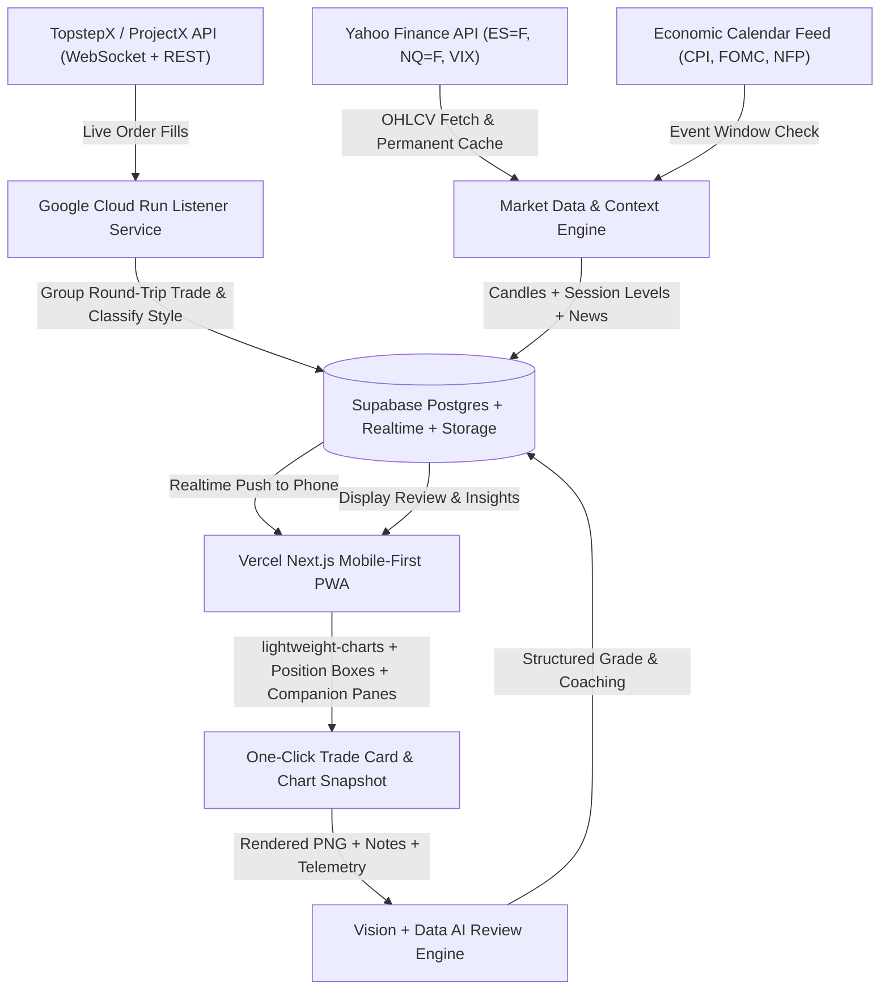

# MogMine — Mobile-First AI Trade Review & Performance Platform

> **Mission:** Give TopstepX futures traders an instant, obsidian-and-gold mobile command center to inspect every trade visually, attach intermarket divergence context, log quick or deep notes, generate shareable Trade Cards, and receive rigorous multimodal AI coaching.

---

## 1. Project Vision

**Current build context:** no broker account exists yet (`D-009`). The first phone frontend is live with ten demo trades ([NOTES.md](NOTES.md)). Manual entry, demo trades and fixtures are the current trade sources; broker/CSV work is parked. The lifecycle below describes the longer-term vision. [docs/10](docs/10-yahoo-first-build-plan.md) explains the Yahoo-first build proposal; [docs/11](docs/11-product-workflows-and-api-context.md) records the newer mobile workflow and assistant API proposals without expanding approved scope.

Most trading journals feel like desktop spreadsheets bolted onto a cramped browser tab. **MogMine** is built **mobile-first** from day one, hosted on **Vercel**, and engineered specifically for intraday futures traders—starting with **`MES` (Micro E-mini S&P 500)** on **TopstepX** and designed with pluggable adapters to grow across instruments, data feeds, and eventually multiple users.

When a trade closes:
1. **Capture:** A persistent **Google Cloud Run** listener connected to the **TopstepX (ProjectX Gateway) API** records raw fills, groups them into a complete round-trip trade, and writes to **Supabase**.
2. **Enrich & Cache:** The system classifies the trade automatically (**Scalp**, **90-Min Session Trade**, or **Investment/Swing**), fetches **Yahoo Finance** OHLCV candles (`ES=F`, `NQ=F`, etc.) before intraday history expires, computes **Session Key Levels** (`ONH/ONL`, `PDH/PDL`, `ORB`, `VWAP`), and checks **High-Impact Economic News** (`CPI`, `FOMC`, `NFP`).
3. **Notify & Visualize:** **Supabase Realtime** pushes the trade directly to your phone. You open a crisp **TradingView `lightweight-charts`** view featuring custom **translucent Position Boxes** (profit/target and stop/MAE zones) and optional **time-synced Companion Charts** (e.g., `NQ=F` to document SMT divergence or correlated pushes).
4. **Journal & Review:** Log notes in under 10 seconds (**Simple Mode** with 1-tap tags & voice memo) or dive into **Advanced Mode** (playbook checklists, divergence breakdowns, post-exit action). Tap one button for a **Quality Trade Card** and a **Vision + Data AI Review** that sees both your chart image and the underlying market telemetry.

---

## 2. System Overview

---

## 3. Core Pillars

| Pillar | What Makes MogMine Different |
| :--- | :--- |
| **Day-Trading Chart Intelligence** | Auto-classifies trades into **Scalp** (`< 15m` → `1m` chart), **90-Min Trade** (`15m–2h` → `5m` chart), or **Swing/Investment** (`> 1 session` → `1h/1d` chart) and caches Yahoo Finance intraday bars permanently in Postgres. |
| **Translucent Position Boxes** | Custom HTML5 Canvas primitives layered inside `lightweight-charts` draw adjustable-opacity Profit/Target and Risk/MAE boxes plus execution path connectors directly on mobile touch charts. |
| **Companion Divergence Charts** | Attach a time-synced `NQ=F` (or `^VIX`, `DX-Y.NYB`) pane or uploaded screenshot directly to any `MES` trade to document SMT divergence and intermarket pushes. |
| **Dual-Speed Note-Taking** | **Simple Mode** captures playbook pills, reason tags, and voice-to-structured-note memos in `< 10s` during the session; **Advanced Mode** unlocks rule checklists, post-exit reviews, and AI Q&A after the bell. |
| **One-Click Quality Trade Cards** | Generates a clean, exportable Trade Card combining the chart + translucent box, key levels, playbook adherence, and AI verdict in a single tap. |
| **Vision + Data AI Coach** | Evaluates 6 live context streams—executions, cached OHLCV + key levels, companion divergence data, economic calendar hazards, playbook rules/notes, and a screenshot of the rendered chart itself. |
| **Adjustable Obsidian & Gold UI** | Deep carbon surfaces with user-tunable gold gradient presets, gold intensity slider, and position-box opacity controls. |

---

## 4. Documentation Index

Read the planning documents in order for the complete technical and product specification:

0. **[AGENTS.md — Coding Agent & Subagent Guide](AGENTS.md)**  
   Start here if you are an AI coding agent or subagent: fast doc routing, the 7 non-negotiable architectural invariants, and the mobile verification checklist.
1. **[01 — Architecture, Stack Brainstorm & Growth Pattern](docs/01-architecture-and-stack.md)**  
   Frontend/backend comparisons, why Vercel + Supabase + Google Cloud Run fit together, trade lifecycle sequence diagram, and the pluggable adapter interfaces (`MarketDataProvider`, `TradeIngestionAdapter`, `ReviewContextPlugin`).
2. **[02 — Charting, Translucent Position Boxes & Divergence](docs/02-charting-position-boxes-and-divergence.md)**  
   Why `lightweight-charts` v4+ beats raw Canvas, custom Canvas primitive specs for Position Boxes, Scalp/90m/Investment logic, Yahoo Finance caching rules, `MES` & companion chart SMT divergence workflows, and automated Session Key Levels.
3. **[03 — One-Click Trade Cards & Note-Taking](docs/03-trade-cards-and-note-taking.md)**  
   Anatomy and export pipeline for the Quality Trade Card, plus the `< 10s` Simple Mode (1-tap + Voice Memo) and post-market Advanced Mode journaling system.
4. **[04 — Multimodal AI Review Engine](docs/04-ai-review-engine.md)**  
   How the 6 context inputs (including Vision AI chart snapshots and Economic Calendar checks) feed the AI coach, and the strict TypeScript/JSON review schema.
5. **[05 — Mobile UX & Adjustable Gold Design System](docs/05-mobile-ux-and-gold-design-system.md)**  
   Mobile-first navigation, thumb-zone ergonomics, progressive disclosure, Obsidian color palette, and CSS-variable architecture for Gold Gradient Presets & Position Box Opacity.
6. **[06 — Supabase Data Model & Build Roadmap](docs/06-data-model-and-roadmap.md)**  
   Full Postgres ER diagram, table specifications (single-user first, multi-user ready), and the 5-phase build roadmap from MVP UI to live TopstepX Cloud Run ingestion.
7. **[07 — Agent Guardrails & Smart Notes](docs/07-agent-guardrails-and-smart-notes.md)**  
   Copy-paste "Wrong vs. Right" recipes for `ISeriesPrimitive` Position Boxes, chart time-sync loop guards, Yahoo padding windows, futures multiplier math (`MES` vs `ES`), and subagent task slicing.
8. **[08 — UX Notes: Viewing Trades & Journaling](docs/08-ux-notes-viewing-and-journaling.md)**  
   Measurable experience budgets, the state matrix for every screen (loading, empty, late data, offline), the gesture conflict map, notes that are never lost, notification etiquette, accessibility, and number and time formatting.
9. **[09 — Backend Risk Register](docs/09-backend-risk-register.md)**  
   What breaks if the blueprint is built as written, with fixes: Topstep's read-only server rule, the fill ledger, candle enrichment passes, session and money math, Supabase security, Vercel limits, the AI pipeline, proposed schema changes, and a log of what was verified against vendor docs.
10. **[10 — Yahoo-First Build Plan](docs/10-yahoo-first-build-plan.md)**  
   **Start here to build.** There is no broker account yet, so this covers Yahoo's measured limits (`1m` bars go back 30 days), the daily candle archive to start first, how to get trades without a broker, and a build order in six milestones with a list of what is parked.

11. **[11 — Mobile Workflows, Chart Context & Assistant API](docs/11-product-workflows-and-api-context.md)**  
   Daily planning and quick capture beyond the chart, independent detail/full-chart controls, anchored notes and zones, reproducible indicator context, assistant draft permissions, and acceptance scenarios. Proposals tracked as `OD-17`–`OD-19`.
12. **[12 — Levels, Zones & the Daily Markup](docs/12-levels-zones-and-daily-markup.md)**  
   The owner's premarket markup as a proposal: level formulas (prior day, overnight, pivots, ADR Pivots), zone merging, role colours and right-edge labels, level-set revisions and trade snapshots, risk-sized and planned/actual/archived boxes, AI level facts, missed moves, and the assistant level-set draft. Proposals tracked as `OD-20`–`OD-23`.
13. **[13 — Bold UI Bets](docs/13-bold-ui-bets.md)**  
   Interface bets shaped by how the owner trades: the Zone Ladder, days instead of trades in the feed, blind review, drawing a trade on the chart, desk mode and the plan-versus-actual execution diff. Bets, not scope (`BET-nn`).
14. **[14 — UI & Experience: Phased Plan](docs/14-ui-phased-plan.md)**  
   The `ui/phased-improvements` branch: what phases 1–3 built, the proposed phases 4–6 (starting with a chart window sized from each trade's own duration), and the questions waiting for the owner.
15. **[15 — Trade Document & Render Grammar](docs/15-trade-document-and-render-grammar.md)**  
   The `mogmine.trade.v1` event document, how it becomes marks for the chart, Trade Card and AI review, the plan, actual and excursion layers, stop paths, hindsight and the seven example trades in `fixtures/trades/`. Open decisions `OD-30`–`OD-34`.
16. **[16 — Floor Roadmap](docs/16-floor-roadmap.md)**  
   The ordered work list from the owner's 2026-11-16 review (`R-01`–`R-09`): pinch zoom, fresh-candle retry, open trades, then the archive, trades in Supabase, the assistant endpoint, playbooks, stats and challenges. Each step names its files, its limits and its done-when.

---

## 5. Working in This Repo

| File | What it is for |
| :--- | :--- |
| [AGENTS.md](AGENTS.md) | Rules that must not be broken, and which spec to read. Every AI agent starts here. |
| [CONTRIBUTING.md](CONTRIBUTING.md) | How people and agents work together: lanes, branches, handoffs, fixtures, environments. |
| [DECISIONS.md](DECISIONS.md) | What is decided, what is open, and which name is canonical when specs disagree. |
| [NOTES.md](NOTES.md) | The current state, who is working on what, and the latest handoff. |
| [mogprompt.md](mogprompt.md) | The whole system in one long read. Where it differs from `docs/`, see `DECISIONS.md`. |
