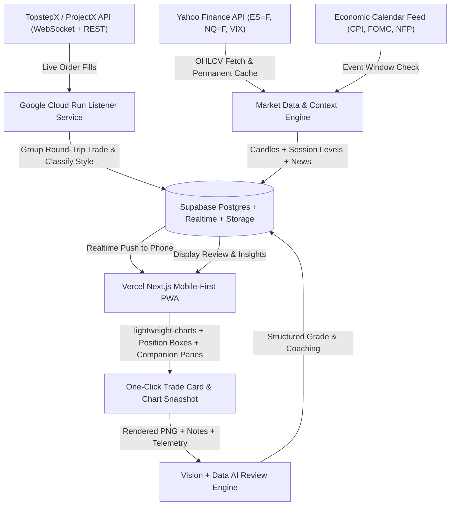

# MogMine — Mobile-First AI Trade Review & Performance Platform

> **Mission:** Give TopstepX futures traders an instant, obsidian-and-gold mobile command center to inspect every trade visually, attach intermarket divergence context, log quick or deep notes, generate shareable Trade Cards, and receive rigorous multimodal AI coaching.

---

## 1. Project Vision

Most trading journals feel like desktop spreadsheets bolted onto a cramped browser tab. **MogMine** is built **mobile-first** from day one, hosted on **Vercel**, and engineered specifically for intraday futures traders—starting with **`MES` (Micro E-mini S&P 500)** on **TopstepX** and designed with pluggable adapters to grow across instruments, data feeds, and eventually multiple users.

When a trade closes:
1. **Capture:** A persistent **Google Cloud Run** listener connected to the **TopstepX (ProjectX Gateway) API** records raw fills, groups them into a complete round-trip trade, and writes to **Supabase**.
2. **Enrich & Cache:** The system classifies the trade automatically (**Scalp**, **90-Min Session Trade**, or **Investment/Swing**), fetches **Yahoo Finance** OHLCV candles (`ES=F`, `NQ=F`, etc.) before intraday history expires, computes **Session Key Levels** (`ONH/ONL`, `PDH/PDL`, `ORB`, `VWAP`), and checks **High-Impact Economic News** (`CPI`, `FOMC`, `NFP`).
3. **Notify & Visualize:** **Supabase Realtime** pushes the trade directly to your phone. You open a crisp **TradingView `lightweight-charts`** view featuring custom **translucent Position Boxes** (profit/target and stop/MAE zones) and optional **time-synced Companion Charts** (e.g., `NQ=F` to document SMT divergence or correlated pushes).
4. **Journal & Review:** Log notes in under 10 seconds (**Simple Mode** with 1-tap tags & voice memo) or dive into **Advanced Mode** (playbook checklists, divergence breakdowns, post-exit action). Tap one button for a **Quality Trade Card** and a **Vision + Data AI Review** that sees both your chart image and the underlying market telemetry.

---

## 2. System Overview

---

## 3. Core Pillars

| Pillar | What Makes MogMine Different |
| :--- | :--- |
| **Day-Trading Chart Intelligence** | Auto-classifies trades into **Scalp** (`< 15m` → `1m` chart), **90-Min Trade** (`15m–2h` → `5m` chart), or **Swing/Investment** (`> 1 session` → `1h/1d` chart) and caches Yahoo Finance intraday bars permanently in Postgres. |
| **Translucent Position Boxes** | Custom HTML5 Canvas primitives layered inside `lightweight-charts` draw adjustable-opacity Profit/Target and Risk/MAE boxes plus execution path connectors directly on mobile touch charts. |
| **Companion Divergence Charts** | Attach a time-synced `NQ=F` (or `^VIX`, `DX-Y.NYB`) pane or uploaded screenshot directly to any `MES` trade to document SMT divergence and intermarket pushes. |
| **Dual-Speed Note-Taking** | **Simple Mode** captures playbook pills, reason tags, and voice-to-structured-note memos in `< 10s` during the session; **Advanced Mode** unlocks rule checklists, post-exit reviews, and AI Q&A after the bell. |
| **One-Click Quality Trade Cards** | Generates a clean, exportable Trade Card combining the chart + translucent box, key levels, playbook adherence, and AI verdict in a single tap. |
| **Vision + Data AI Coach** | Evaluates 6 live context streams—executions, cached OHLCV + key levels, companion divergence data, economic calendar hazards, playbook rules/notes, and a screenshot of the rendered chart itself. |
| **Adjustable Obsidian & Gold UI** | Deep carbon surfaces with user-tunable gold gradient presets, gold intensity slider, and position-box opacity controls. |

---

## 4. Documentation Index

Read the planning documents in order for the complete technical and product specification:

0. **[AGENTS.md — Coding Agent & Subagent Guide](file:///c:/mogmine/AGENTS.md)**  
   Start here if you are an AI coding agent or subagent: fast doc routing, the 7 non-negotiable architectural invariants, and the mobile verification checklist.
1. **[01 — Architecture, Stack Brainstorm & Growth Pattern](file:///c:/mogmine/docs/01-architecture-and-stack.md)**  
   Frontend/backend comparisons, why Vercel + Supabase + Google Cloud Run fit together, trade lifecycle sequence diagram, and the pluggable adapter interfaces (`MarketDataProvider`, `TradeIngestionAdapter`, `ReviewContextPlugin`).
2. **[02 — Charting, Translucent Position Boxes & Divergence](file:///c:/mogmine/docs/02-charting-position-boxes-and-divergence.md)**  
   Why `lightweight-charts` v4+ beats raw Canvas, custom Canvas primitive specs for Position Boxes, Scalp/90m/Investment logic, Yahoo Finance caching rules, `MES` & companion chart SMT divergence workflows, and automated Session Key Levels.
3. **[03 — One-Click Trade Cards & Note-Taking](file:///c:/mogmine/docs/03-trade-cards-and-note-taking.md)**  
   Anatomy and export pipeline for the Quality Trade Card, plus the `< 10s` Simple Mode (1-tap + Voice Memo) and post-market Advanced Mode journaling system.
4. **[04 — Multimodal AI Review Engine](file:///c:/mogmine/docs/04-ai-review-engine.md)**  
   How the 6 context inputs (including Vision AI chart snapshots and Economic Calendar checks) feed the AI coach, and the strict TypeScript/JSON review schema.
5. **[05 — Mobile UX & Adjustable Gold Design System](file:///c:/mogmine/docs/05-mobile-ux-and-gold-design-system.md)**  
   Mobile-first navigation, thumb-zone ergonomics, progressive disclosure, Obsidian color palette, and CSS-variable architecture for Gold Gradient Presets & Position Box Opacity.
6. **[06 — Supabase Data Model & Build Roadmap](file:///c:/mogmine/docs/06-data-model-and-roadmap.md)**  
   Full Postgres ER diagram, table specifications (single-user first, multi-user ready), and the 5-phase build roadmap from MVP UI to live TopstepX Cloud Run ingestion.
7. **[07 — Agent Guardrails & Smart Notes](file:///c:/mogmine/docs/07-agent-guardrails-and-smart-notes.md)**  
   Copy-paste "Wrong vs. Right" recipes for `ISeriesPrimitive` Position Boxes, chart time-sync loop guards, Yahoo padding windows, futures multiplier math (`MES` vs `ES`), and subagent task slicing.
