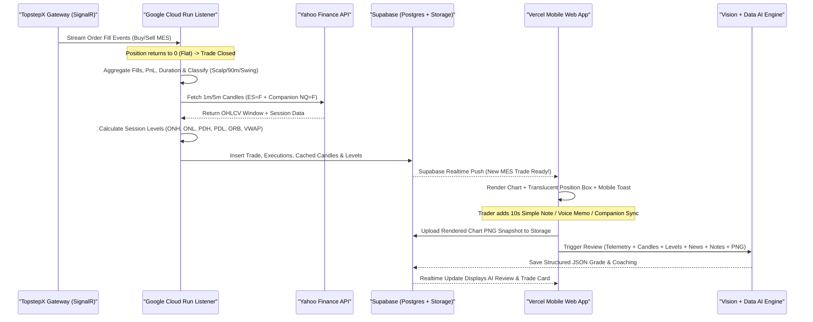

# 01 — Architecture, Stack Brainstorm & Growth Pattern

This document captures the architectural decisions behind **MogMine**, compares backend/frontend alternatives, and defines the adapter boundaries so the platform starts fast on free/low-cost services (`Yahoo Finance`, single-user `Supabase`, `Vercel`) while staying cleanly extensible.

---

## 1. Stack Brainstorming & Final Selection

### A. Frontend & Web Hosting Brainstorm

| Option | Pros | Cons | Verdict |
| :--- | :--- | :--- | :--- |
| **Next.js (App Router, TypeScript) on Vercel + PWA** | Instant mobile deployment via URL, installs on iOS/Android home screen as a PWA, shares TypeScript types directly with API routes/AI SDK, zero App Store friction, effortless PNG/OG card generation. | No native iOS background push without Web Push API setup (solved cleanly with PWA Web Push + Supabase Realtime). | **Selected** |
| **React Native / Expo** | Native mobile gestures and local notifications. | Harder to share web-native `lightweight-charts` canvas primitives; slower iteration vs. Vercel preview deploys; App Store review overhead for a personal tool. | Future Phase (reuses backend APIs) |
| **Vite + React SPA** | Very fast client build. | Lacks built-in server API routes for hiding AI/Yahoo/Supabase service keys and generating server-side Trade Card snapshots. | Rejected |

### B. Database & State Layer Brainstorm

| Option | Pros | Cons | Verdict |
| :--- | :--- | :--- | :--- |
| **Supabase (Postgres + Realtime + Storage + Auth)** | Built-in **Realtime** pushes closed trades from Cloud Run to your phone screen immediately; relational SQL joins trades, fills, and playbooks; `JSONB` stores cached Yahoo candle arrays cleanly; **Storage** hosts Trade Card PNGs & Vision AI screenshots; Auth is ready whenever multi-user mode is turned on. | Slight learning curve around Row Level Security (RLS) when expanding to multi-user. | **Selected** |
| **Neon Serverless Postgres + Drizzle** | Great branching and serverless pooling. | Lacks built-in Realtime WebSocket subscriptions and file storage buckets—would require extra services (Pusher/Ably + S3/R2). | Runner-up |
| **Firebase / Firestore** | Google Cloud native alongside Cloud Run. | NoSQL document model becomes awkward for complex financial queries (MAE/MFE aggregations, R-multiple grouping, OHLCV window lookups). | Rejected |

### C. TopstepX Listener Infrastructure Brainstorm

| Option | Pros | Cons | Verdict |
| :--- | :--- | :--- | :--- |
| **Google Cloud Run (Node.js/TypeScript)** | Runs a persistent container capable of holding long-lived SignalR/WebSocket connections to the TopstepX (ProjectX Gateway) API; auto-restarts on crash; cheap (scales down outside market hours or runs 1 minimal instance during NY/Globex sessions); shares TypeScript models with the Vercel repo. | Needs a health-check endpoint and keep-alive strategy so Cloud Run doesn't idle-throttle an open WebSocket (`min-instances = 1` or `--no-cpu-throttling`). | **Selected** |
| **Vercel Serverless Functions Only** | Zero extra infrastructure. | Cannot hold persistent WebSocket/SignalR connections; functions time out after seconds, risking missed fills. | Rejected for Listener (Used for Web/AI APIs) |
| **Dedicated VPS (EC2 / DigitalOcean)** | Always-on process. | Manual OS patching, TLS setup, and log management overhead compared to Cloud Run's managed containers. | Rejected |

---

## 2. Single-User First, Multi-User Ready

MogMine launches as a **single-user personal trading workbench** so we skip onboarding flows, billing, and complex OAuth friction during Phases 1–4. However, every table in Supabase (`accounts`, `trades`, `playbooks`, `user_preferences`) still carries a `user_id` UUID column tied to a default single-owner profile. When you are ready to invite other traders or launch publicly:
1. Enable **Supabase Auth** (Magic Link / Google / Email).
2. Activate **Row Level Security (RLS)** policies (`auth.uid() = user_id`).
3. Move TopstepX API credentials into an encrypted per-user vault (e.g., Supabase Vault or Google Secret Manager).

Zero schema rewrites are needed.

---

## 3. End-to-End Trade Lifecycle



---

## 4. "Programmed to Grow" — Pluggable Adapter Interfaces

To ensure MogMine can start with **Yahoo Finance** and **Manual/CSV + TopstepX** today and grow into tick-level data feeds (`Databento`, `Polygon`, `TopstepX Historical Bars`) and richer AI plugins tomorrow, all external dependencies sit behind strict TypeScript interfaces in a shared `packages/core` (or `src/lib/adapters/`) module.

### A. `MarketDataProvider` Interface
Starts with `YahooFinanceProvider`. Future providers implement the exact same contract so neither the chart component nor the AI engine cares where candles came from.

```typescript
export type Timeframe = '1m' | '2m' | '5m' | '15m' | '1h' | '1d';

export interface Candle {
  time: number; // Unix timestamp in seconds (UTC)
  open: number;
  high: number;
  low: number;
  close: number;
  volume: number;
}

export interface MarketDataQuery {
  symbol: string;       // Canonical ticker e.g. 'MES' or 'MNQ'
  timeframe: Timeframe;
  from: Date;
  to: Date;
}

export interface MarketDataProvider {
  readonly name: string; // e.g., 'yahoo_finance', 'databento', 'topstepx_bars'
  resolveProviderSymbol(canonicalSymbol: string): string;
  getCandles(query: MarketDataQuery): Promise<Candle[]>;
  supportsTickData(): boolean;
}
```

### B. `TradeIngestionAdapter` Interface
Allows Phase 1 & 2 UI development using manual entry or TopstepX CSV exports before the live Cloud Run SignalR stream is switched on in Phase 4.

```typescript
export interface RawExecutionInput {
  externalFillId: string;
  accountId: string;
  symbol: string;       // e.g., 'MES'
  side: 'BUY' | 'SELL';
  quantity: number;
  price: number;
  filledAt: Date;
  commission?: number;
}

export interface NormalizedTradeInput {
  accountId: string;
  symbol: string;
  direction: 'LONG' | 'SHORT';
  entryTime: Date;
  exitTime: Date;
  entryPrice: number;
  exitPrice: number;
  quantity: number;
  grossPnl: number;
  netPnl: number;
  executions: RawExecutionInput[];
}

export interface TradeIngestionAdapter {
  readonly source: 'topstepx_stream' | 'csv_import' | 'manual_entry';
  ingest(payload: unknown): Promise<NormalizedTradeInput[]>;
}
```

### C. `ReviewContextPlugin` Interface
Keeps the AI review pipeline modular. Adding a new data source (e.g., Options Gamma Exposure, Footprint Delta, or Economic Calendar) means registering one new plugin—never rewriting the core review prompt builder.

```typescript
export interface ReviewContextBlock {
  pluginId: string;
  title: string;
  summaryText: string;
  structuredData: Record<string, unknown>;
  imageAttachments?: Array<{
    mimeType: 'image/png' | 'image/jpeg';
    url: string;
    caption: string;
  }>;
}

export interface ReviewContextPlugin {
  readonly id: string;
  readonly priority: number;
  buildContext(tradeId: string): Promise<ReviewContextBlock | null>;
}
```

### Initial Plugin Registry
1. `ExecutionTelemetryPlugin` — TopstepX fills, scaling, duration, `Scalp / 90m / Investment` tag, MAE/MFE.
2. `PriceActionAndLevelsPlugin` — Cached Yahoo Finance OHLCV + `ONH/ONL`, `PDH/PDL`, `ORB`, `VWAP`.
3. `CompanionDivergencePlugin` — Synced `NQ=F` / `^VIX` candles & trader divergence annotations.
4. `EconomicCalendarPlugin` — High-impact USD news proximity check (`CPI`, `FOMC`, `NFP`).
5. `PlaybookAndNotesPlugin` — Playbook checklist adherence + Simple/Advanced/Voice notes.
6. `ChartVisionSnapshotPlugin` — High-res PNG of the rendered chart with translucent Position Boxes.
