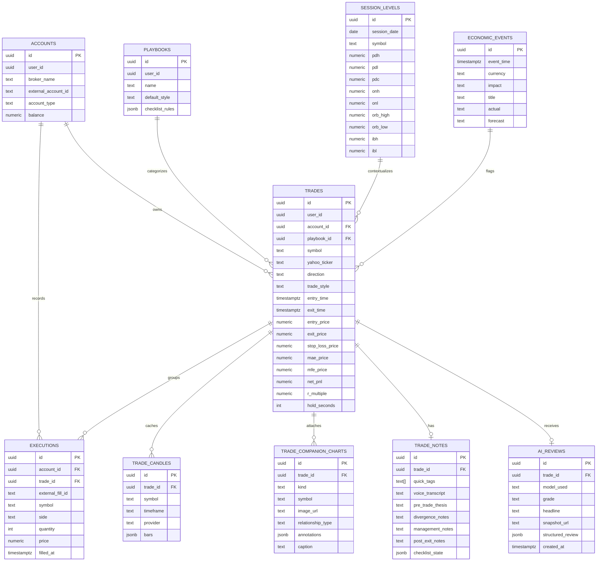

# 06 — Supabase Data Model & Phased Build Roadmap

This document defines the relational PostgreSQL schema hosted on **Supabase** and lays out a pragmatic **5-phase build roadmap** designed to deliver a working mobile app on Vercel first, then layer in AI Vision reviews and live Google Cloud Run TopstepX streaming.

---

## 1. Entity-Relationship Diagram

---

> [!WARNING]
> **This model has gaps that lose or expose data.** Fills cannot be saved before a trade closes, a reversal fill belongs to two trades, there is no RLS, deletes cascade through the whole journal, and candles are stored per trade although session levels need whole sessions. Proposed changes are in [09 — Backend Risk Register §8](09-backend-risk-register.md#8-proposed-schema-changes), tracked as `OD-2`, `OD-4` and `OD-5` in [DECISIONS.md](../DECISIONS.md). Column names here are the interim canonical set where they differ from `mogprompt.md` (`OD-1`).

## 2. Core Table Specifications

| Table | Purpose & Key Columns |
| :--- | :--- |
| **`accounts`** | Tracks TopstepX Combine / Express Funded / Live accounts (`external_account_id`, `account_type`, `balance`, `user_id`). |
| **`executions`** | Immutable raw order fills from TopstepX (`external_fill_id` unique constraint prevents duplicate writes on WebSocket reconnects). |
| **`trades`** | Aggregated round-trip positions. Stores `trade_style` (`'scalp' \| 'session_90m' \| 'investment'`), `style_overridden` boolean, `entry_price`, `exit_price`, `stop_loss_price`, `mae_price`, `mfe_price`, `r_multiple`, `net_pnl`, and `session_tag` (`'NY_AM' \| 'NY_PM' \| 'LONDON' \| 'ASIA'`). |
| **`trade_candles`** | Permanently caches Yahoo Finance OHLCV arrays (`bars` JSONB of `{ time, open, high, low, close, volume }`) keyed by `(trade_id, symbol, timeframe)` so `1m` intraday history never vanishes after 30 days. |
| **`trade_companion_charts`** | Stores secondary charts attached to a trade: either `kind = 'yahoo_sync'` (e.g., `NQ=F`, `^VIX` with `relationship_type = 'smt_divergence' \| 'confirming_push'` and 2-point `annotations` coordinates) or `kind = 'uploaded_image'` (Supabase Storage URL + caption). |
| **`session_levels`** | One row per `(session_date, symbol)` holding `pdh`, `pdl`, `pdc`, `onh`, `onl`, `orb_high`, `orb_low`, `ibh`, `ibl` so multiple trades on the same day share the same levels. |
| **`economic_events`** | Stores scheduled/fetched Tier-1 USD economic releases (`CPI`, `FOMC`, `NFP`, `PPI`, `ISM`) for ±30m trade hazard checks. |
| **`playbooks`** | User-defined setups (e.g., *"ONL Sweep + NQ SMT"*), each with an ordered `checklist_rules` array (`[{ id, label, required }]`). |
| **`trade_notes`** | Combines **Simple Mode** (`quick_tags`, `voice_audio_url`, `voice_transcript`, `mood_tag`) and **Advanced Mode** (`pre_trade_thesis`, `divergence_notes`, `management_notes`, `post_exit_notes`, `checklist_state`). |
| **`ai_reviews`** | Stores the Zod-validated `AITradeReviewOutput` JSON, `grade`, `snapshot_url` (Vision AI / Trade Card screenshot), `playbook_adherence_score`, and follow-up coach chat history. |
| **`user_preferences`** | Persists UI visual tuning: `gold_preset` (`'bullion' \| 'champagne' \| 'amber' \| 'platinum'`), `gold_intensity` (`0.0–1.0`), `position_box_opacity` (`0.15–0.65`), and `default_companion_tickers` (e.g., `['NQ=F']`). |

---

## 3. Phased Build Roadmap

> [!NOTE]
> Each phase has gate items in [09 — Backend Risk Register §9](09-backend-risk-register.md#9-phase-gates). Two roadmap changes are proposed in [DECISIONS.md](../DECISIONS.md): a stateless **Sync from TopstepX** pull in Phase 1, ahead of the Cloud Run listener (`OD-3`), and a narrower first version of the experience (`OD-14`, [08 §15](08-ux-notes-viewing-and-journaling.md#15-build-order-for-the-experience)).

### Phase 1: Vercel App, Obsidian/Gold Theme & Core Chart Engine
- Scaffold Next.js (App Router, TypeScript, Tailwind CSS, PWA manifest) in the workspace and deploy preview to **Vercel**.
- Connect **Supabase** project and run initial SQL migrations (`trades`, `trade_candles`, `user_preferences`).
- Implement the **Obsidian & Adjustable Gold** CSS variable system + Visual Tuning drawer (`gold_preset`, `gold_intensity`, `position_box_opacity`).
- Build `YahooFinanceProvider` (`ES=F`, `NQ=F`) + permanent Supabase caching.
- Build the `lightweight-charts` component with the custom **`PositionBoxPrimitive`** (translucent profit & risk/MAE zones + diagonal execution path).
- Build a **Manual / CSV TopstepX Importer** so you can upload real `MES` trades immediately and test the mobile UI right away.

### Phase 2: Companion Divergence Charts, Levels, Notes & Trade Cards
- Add automated **Session Key Levels** calculation (`PDH/PDL`, `ONH/ONL`, `ORB`, `VWAP`) and toggle pills on the chart.
- Build **Companion Chart Panes**: attach time-synced `NQ=F` / `^VIX` charts with crosshair lock and 2-point divergence/push trendlines, plus image upload support.
- Build **Simple Mode** (`< 10s` 1-tap Playbook/Reason chips + Voice Memo transcription/auto-tagging) and **Advanced Mode** (Playbook checklists + structured deep notes).
- Build the **One-Click Quality Trade Card** modal and high-res PNG export pipeline + Supabase Storage upload.

### Phase 3: Full-Context + Vision AI Review Engine
- Implement `EconomicCalendarPlugin` (high-impact USD event lookup).
- Implement all 6 `ReviewContextPlugin` modules and wire the **Vercel AI SDK** multimodal review endpoint (sending both structured telemetry/levels/divergence JSON and the chart PNG snapshot).
- Validate outputs against the strict `AITradeReviewOutput` Zod schema, display grades/insights in the mobile UI, and embed the AI headline into exported Trade Cards.

### Phase 4: Google Cloud Run TopstepX Listener
- Create the standalone Node.js/TypeScript listener service for **Google Cloud Run**.
- Authenticate with the **TopstepX (ProjectX Gateway) API** and subscribe to live order fill streams via SignalR/WebSocket.
- Implement stateful fill aggregation (detect position open → scale-ins/outs → flat close), auto-classify (`scalp` / `session_90m` / `investment`), trigger immediate Yahoo Finance candle caching, and insert into Supabase.
- Enable **Supabase Realtime** subscriptions in the Vercel mobile app so closed `MES` trades appear on your phone within seconds.

### Phase 5: Scale & Future Upgrades
- Add a **`TopstepXNativeBarsProvider`** or **`DatabentoProvider`** implementing `MarketDataProvider` for sub-minute/tick fidelity without touching UI components.
- Expand analytics dashboard (win rate by `Scalp` vs `90m Trade`, SMT Divergence edge stats, Playbook expectancy, Time-of-Day heatmap).
- Optionally turn on **Supabase Auth + RLS** if you ever want to open MogMine to other traders.
