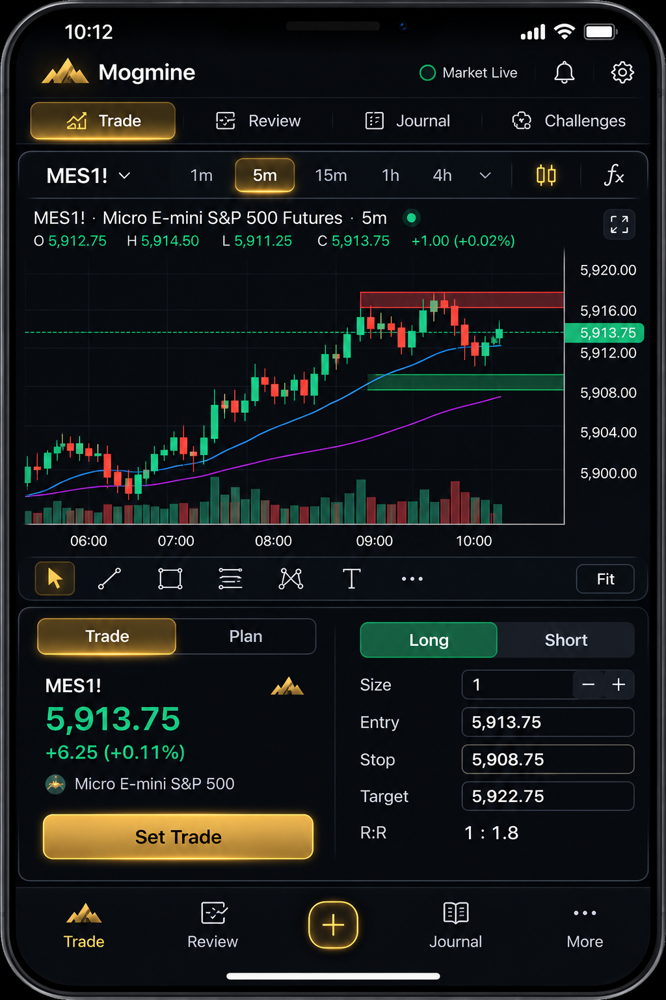
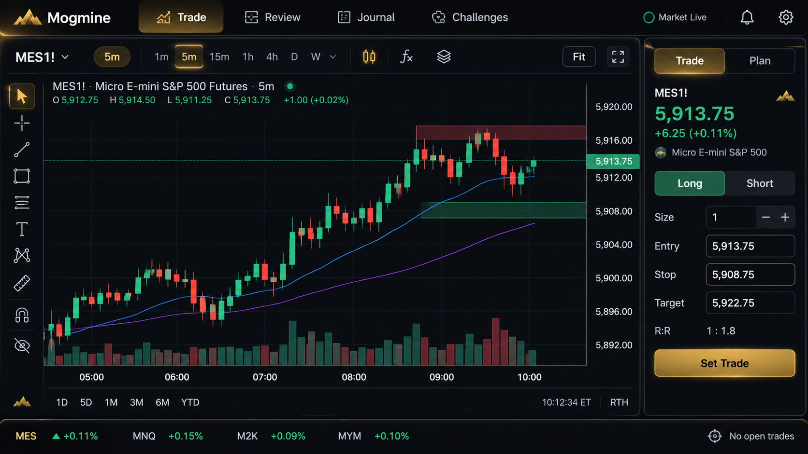

# 19 — Design Guide: Trade Screen Mockups

Two mockups from the owner (2026-11-20) that show the direction for the main trade screen on phone and desktop. They are **a guide, not a spec**. They predate the Mood Shape ([18](18-mood-shape.md)) and do not show it. Where a mockup disagrees with a decision on record, the decision holds until the owner closes `OD-40` in [DECISIONS.md](../DECISIONS.md).

| Phone (390-class) | Desktop |
| :---: | :---: |
|  |  |

---

## 1. What the mockups show

- **Top bar:** brand, a market status badge, notifications, settings. Main tabs are Trade, Review, Journal and Challenges. On the phone they also appear in a bottom dock with a centre ＋.
- **Chart card:** a symbol picker (`MES1!`), timeframe pills (1m, 5m, 15m, 1h, 4h, D, W), candle type, indicators (`fx`), layers, Fit, full screen. An OHLC readout line. Two moving averages. A volume pane. Red and green horizontal zones. A last-price tag on the axis.
- **Drawing tools:** select, crosshair, line, rectangle, levels, text, path, measure, magnet and hide. They sit in a row under the chart on the phone and in a left rail on desktop.
- **Desktop range bar:** 1D, 5D, 1M, 3M, 6M, YTD, the clock in ET, and `RTH`.
- **Entry panel:** Trade / Plan toggle, the symbol and last price, Long / Short, Size with steppers, Entry, Stop, Target, R:R, and a full-width primary button.
- **Desktop bottom strip:** MES, MNQ, M2K and MYM percent change, and "No open trades".

## 2. How it maps to what exists and what is planned

| Mockup part | Where it lives | State |
| :--- | :--- | :--- |
| Chart card, timeframe pills, Fit, full screen | `components/TradeChart.tsx`, `TradeDetail.tsx` | Built (1m–1h). 4h, D and W are not built. |
| Red and green zones | [12](12-levels-zones-and-daily-markup.md) levels and zones, `OD-20`–`OD-23` | Proposal |
| Moving averages, `fx` | [11 §4](11-product-workflows-and-api-context.md) indicator definitions | Proposal |
| Volume pane | Candles carry volume already | Not drawn |
| Drawing tools | [13 §5](13-bold-ui-bets.md#5-bet-04--draw-the-trade) BET-04, [11 §3](11-product-workflows-and-api-context.md) zone tool | Bet, not approved scope |
| Trade / Plan toggle | Not-taken plans, `OD-31`, [15](15-trade-document-and-render-grammar.md) | Data model only |
| Long/Short, Size, Entry, Stop, Target, R:R | `AddTradeSheet.tsx` (`R-03b`), stop frozen at entry (`R-10`) | Built as a sheet. The panel layout is better and is the target. |
| Challenges tab | [17](17-challenges.md), `R-09` | Designed, not built |
| Bottom strip, "No open trades" | Open trades (`R-03`), Yahoo quotes | Not built |
| Range bar (1D … YTD), RTH | Candle archive (`R-04`) for anything past Yahoo's `1m` limit | Not built |

## 3. Where it conflicts with decisions on record (`OD-40`)

1. **Gold on navigation and buttons.** The active tab, the active timeframe pill and the primary button are gold. Issue #80 reserves gold for good process, such as the rules seal. Interim: neutral or white for active and primary states; gold stays on process only.
2. **"Market Live" and a ticking price.** The only source is Yahoo, which is delayed, and its live-session lag is unmeasured (docs/10 §2). Interim: the badge says how old the last bar is ("Delayed · 2 min"), never "Live", until a real-time feed exists.
3. **"Set Trade" beside a live price reads as an order ticket.** The server is read-only against the broker (guardrail B-01), and the app never places orders. Interim: the button says **Log trade** (Trade) or **Save plan** (Plan).
4. **Names.** The mockup uses Trade / Review / Journal / Challenges for the tabs and `MES1!` for the symbol. The app uses Today / Feed / Review / Tune and `MES`. A rename is the owner's call (`OD-1`: never invent a third name). Interim: keep the current names.

Smaller notes: the R:R in the mockup is written `1 : 1.8`; the app writes planned R as `1.8R` (drift register). Prices keep `tabular-nums` (AGENTS §4). Every control in the entry panel needs a ≥ 44 px target.

## 4. Where the Mood Shape fits

- **Entry panel, under R:R:** a one-tap "how do you feel" row when the trade is logged. This is the capture-at-entry moment in `OD-39` (c), and it would give the only clean before-exit mood scores.
- **Desktop bottom strip:** a 40 px shape next to an open trade, in place of "No open trades".
- The shape stays neutral ink, never gold and never profit or loss colour ([18 §1](18-mood-shape.md#1-the-shape)).

## 5. Suggested order, if the owner adopts the direction

1. The entry panel replaces the add-trade sheet (`R-03b` and `R-10` logic unchanged), with the mood tap if `OD-39` (c) is yes.
2. 4h, D and W timeframes and the volume pane (chart lane).
3. Zones and moving averages, after `OD-20` and the indicator definitions in docs/11.
4. The tab rename, if `OD-40` (4) is accepted.
5. Drawing tools, only if BET-04 is approved.
