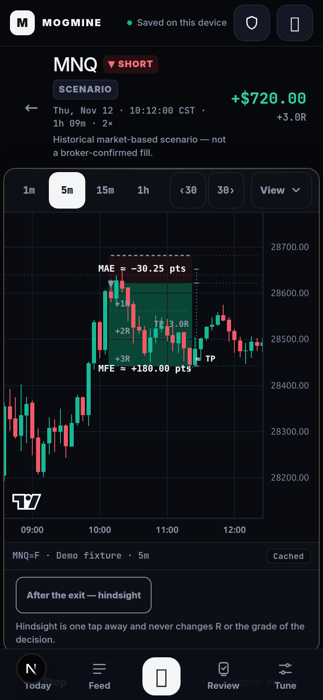
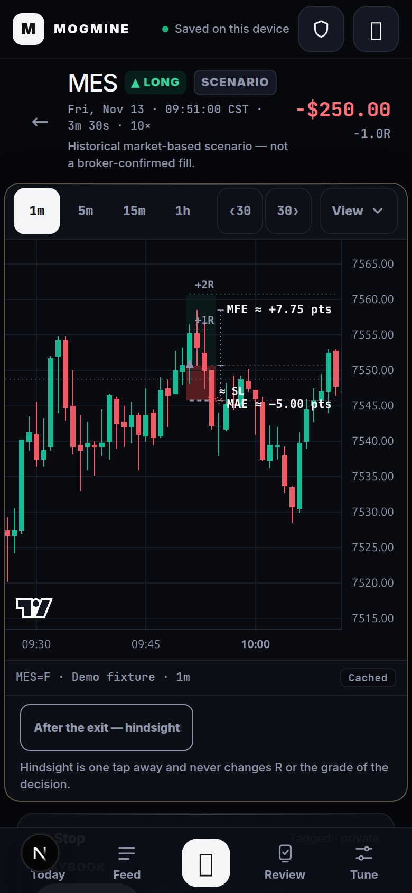
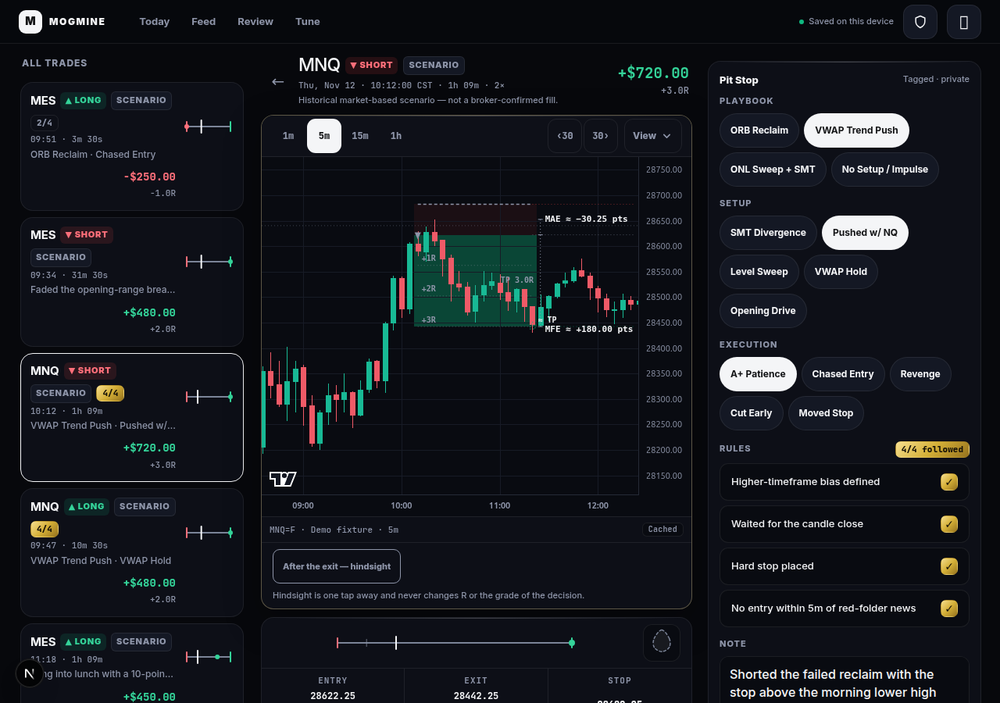

# 08 — Chart visual quality: why the position boxes look "8-bit", and the fix

Source: Chris, 2026-11-24: *"the position boxes look like a big 8-bit computer"* next to TradingView / Sierra Chart / Bookmap. The boxes move with the chart correctly; this document covers **look only**. Design analysis by Claude 5.5 on `origin/main` `22da636`. Docs only: no code changed.

Related: [docs/05](../05-mobile-ux-and-gold-design-system.md) (gold system, `--position-box-opacity`), [docs/12 §5 and LV-18](../12-levels-zones-and-daily-markup.md) (box styles, `D-010`), [docs/15](../15-trade-document-and-render-grammar.md) (display list), [docs/19](../19-design-guide.md) (owner mockups), [03](03-indicators-and-levels.md) (`LB-A`…`LB-B2`, level pills), [02](02-ux.md), [90](90-work-packages.md) (lanes). The new package is **`UX-E` "Modern position zones"** with follow-ups `UX-E2`…`UX-E5` (§7).

Method: read every file in the chart path (cited by `file:line` below), ran the app in local/fixture mode (`npm ci && next dev`, no `.env`, no Supabase, demo fixtures only) and took headless Chrome screenshots at 390×844 (DPR 2) and 1280×900 (DPR 1). Contrast ratios were computed from the composited colours (alpha over the chart background), WCAG 2.x formula.

| 390 px, winning short (MNQ fixture) | 390 px, losing long (MES fixture) |
| :---: | :---: |
|  |  |



---

## 1. Short answer

The boxes do not look cheap because of their colour. A 28 % emerald on near-black is about what TradingView's own long/short tool uses. They look "8-bit" for six reasons:

1. **The wrong fonts.** Every canvas label uses `ui-monospace, SFMono-Regular, Menlo, monospace` at weight 600. Chrome on Android, Windows and Linux does not know `ui-monospace`, so the labels fall back to the system mono: Droid/DejaVu Sans Mono, or **Courier New Bold on Windows**. JetBrains Mono is loaded for the HTML and never reaches the canvas. The axes use the library default (`Trebuchet MS` on Windows), which has proportional digits.
2. **Bare text over candles.** Labels are bold white text with no chip, no halo and no background. They are drawn over and between candles (`MFE ≈ +180.00 pts`, `TP 3.0R`, `+1R +2R +3R`). Text is the loudest layer on the chart.
3. **Flat slabs with no edge.** A box is one `fillRect` with no stroke. Its edges come only from the colour change, which reads as a block of pixels, not a price zone.
4. **Stacked tiers.** The plan fill (0.078 alpha), the actual fill (0.28) and each partial lot (scaled by `qty / max`) are painted on top of one another. The overlaps give stepped bands of nearly the same colour, a posterised look.
5. **Stipple and dither patterns.** `[1, 3]` dots are used for the R ruler, plan extensions, the excursion bracket and anything inferred. A cancelled plan is filled with horizontal dotted scanlines every 3 px, a literal screen-door dither. Stop slippage uses 6 px 45° hatching at 55 %.
6. **No pixel snapping.** Hairlines are stroked at fractional media coordinates. At DPR 1 a 1 px line renders as a blurry 2 px grey line. At DPR 2.625 (common on Android) dots and dashes shimmer.

The fix is a typographic and stroke pass: real fonts, label chips, 1 px crisp edge rules, a soft gradient instead of a slab, one fill tier, and dashes instead of dots. Only paint changes. Marks, hit tests, autoscale and slider behaviour stay the same.

---

## 2. Findings, ranked by visual impact

`file:line` points to where the value is set today.

### F-1 Canvas typography falls back to system mono (impact: very high)

| Where | Today | Problem |
| :--- | :--- | :--- |
| `components/PositionBoxPrimitive.ts:354` | `"600 10px ui-monospace, SFMono-Regular, Menlo, monospace"` for every mark | Neither `ui-monospace` nor SF Mono or Menlo exists on Android, Windows or Linux, so the generic `monospace` is used: DejaVu/Droid Sans Mono, or Courier New on Windows. Weight 600 makes it heavy and blocky. |
| `components/PositionBoxPrimitive.ts:238` | `"600 11px …"` for MFE/MAE bracket labels | Same font problem, one size larger than the other labels. |
| `components/SessionLevelsPrimitive.ts:14` | `"500 11px ui-monospace, …"` | Same fallback. |
| `components/TradeChart.tsx:329` | `layout: { fontSize: 11 }`, no `fontFamily` | The library default is `-apple-system, BlinkMacSystemFont, 'Trebuchet MS', Roboto, Ubuntu, sans-serif`, whose digits are not tabular. The axis does not match the app's `.num` style (`app/globals.css:105`). |
| `app/layout.tsx:11`, `app/globals.css:62` | JetBrains Mono loaded via `next/font` into `--font-mono` | Never read by `lib/theme.ts`, so canvas code cannot use it. |

The screenshots show this: `MFE ≈ +180.00 pts` is in heavy DejaVu Sans Mono.

### F-2 Labels have no chip and sit over candles (very high)

- `PositionBoxPrimitive.ts:365-376` draws queued labels with `fillText` only. There is no background, padding, radius or halo.
- Flag text is white (`textPrimary`, `:258`) at weight 600. Zone labels (`TP 3.0R`) are `textMuted` (`:326-328`) at **4.12:1** on the profit fill, below 4.5:1, and drawn behind the candles in the same pass.
- The R ruler is always on (`components/TradeDetail.tsx:295` `showRuler: true`), which adds `+1R/+2R/+3R` labels (`lib/trade-marks.ts:243-249`) and 3 to 5 dotted lines (`:225-240`) inside the box, on top of the candles.
- The MFE/MAE bracket labels (`PositionBoxPrimitive.ts:243-246`) are the largest text on the chart (11 px / 600) and they describe hindsight, not the trade.
- Result: **labels > boxes > candles**. The order should be **candles > position edges > labels > levels > grid**.

### F-3 Boxes are slabs with no price edges (high)

- `PositionBoxPrimitive.ts:330-339`: `globalAlpha = boxOpacity × opacityMultiplier`, then `fillRect`. No stroke. The rect is snapped with `Math.round` (`:218-221`), which is fine, but nothing draws the edges.
- The composited profit fill is **#0B3C30**, only **1.60:1** against the chart background. Risk is **#491B1F**. The box is visible only as a murky tint. The entry, target and exit prices, the most important information, have no line of their own across the box.
- `docs/12` LV-18 and `D-010` say "no outline" for plan and actual. That ruled out a *frame* (the old purple/teal border). This document proposes horizontal **price edge rules** (top and bottom only, in the tone colour), which is not a frame. That needs an owner decision (**D-V1**, §8).

### F-4 Stacked fill tiers look posterised (high)

- The plan zones (`lib/trade-marks.ts:198-218`, style `faint`) span the same bars as the actual zone (`:309-312`). Both are filled, so the overlap is 0.078 + 0.28 alpha. The parts of the plan box outside the actual one stay at 0.078, at **1.09:1**, which is invisible as a shape but visible as a "step".
- Partial lots draw one zone each, at `opacityMultiplier = qty / max_size` (`trade-marks.ts:312`). A 3-lot scale-out gives three shades of green in steps: the "8-bit" staircase.
- Archived neighbours are capped at 0.10 (`PositionBoxPrimitive.ts:333`) with a dotted 0.65 outline (`:340-345`).

### F-5 Dot, dither and hatch patterns (medium-high)

| Where | Pattern | Problem |
| :--- | :--- | :--- |
| `PositionBoxPrimitive.ts:70` | `dashed = [4, 3]`, `dotted = [1, 3]` | 1 px dots read as pixel stipple, especially at DPR 1 and 2.625. |
| `PositionBoxPrimitive.ts:334-336` | Cancelled plan: dotted horizontal lines every 3 px | A screen-door dither. The most "8-bit" thing in the app. |
| `PositionBoxPrimitive.ts:315-319` | Hatch: 45° lines every 6 px at 0.55 / 0.25 | Visible staircase at DPR 1. Too strong for a secondary fact. |
| `PositionBoxPrimitive.ts:235-242` | Bracket: dotted line with 6 px caps | Fine idea, but stippled and loud. |
| `SessionLevelsPrimitive.ts:90` | Proxy levels `[4, 4]` | OK. |

### F-6 Hairlines are not pixel-snapped (medium)

- `PositionBoxPrimitive.ts:73-78` (`strokeLine`) and everything that calls it draw in `useMediaCoordinateSpace` at raw `priceToCoordinate` values. Odd-width lines need to sit on half device pixels.
- `SessionLevelsPrimitive.ts:68,80` does snap (`Math.round(y) + 0.5`), but in media pixels, which is only right at DPR 1.
- Flags are 4 px triangles at lineWidth 1.25 (`:92-98`, `:255`): too small to anti-alias cleanly, with no outline to separate them from the candles.

### F-7 Hue and saturation (medium)

| Token (`app/globals.css`) | Today | Note |
| :--- | :--- | :--- |
| `--profit-emerald` `:17` | `#10B981` | Fine as a fill hue. Very close to `--candle-up #18B995` (`:28`), so up candles inside a profit box blend in (**4.94:1** up candle on fill, **3.72:1** down candle on fill). |
| `--risk-crimson` `:18` | `#EF4444` | Saturated red; at 0.28 it becomes a brown-maroon (`#491B1F`). |
| `--candle-up/down` `:28-29` | `#18B995` / `#EF5A67` | Good; keep the hues and only fine-tune them. |
| `--chart-bg` `:24` | `#090B11` | Very dark. The leading platforms sit a little lighter (TradingView dark `#131722`) so translucent fills keep their hue instead of going muddy. |
| `--chart-grid` `:25` | `#171B26`, opaque, vertical and horizontal (`TradeChart.tsx:231`) | Slightly busy on a 390 px chart. Vertical lines compete with the box's left and right edges. |
| `--chart-crosshair` `:27` | `#676F82`, library default dash | OK; the label background `--bg-elevated` is a bit dark for its text. |
| `--indicator-vwap` `:46` | `#F472B6`, 1 px (`TradeChart.tsx:346-348`) | Fine, 7.3:1. Use 1.5 px so it reads as a study, not a grid line. |
| Gold | not used on the chart | Correct (gold is reserved for good process, issue #80). Keep the chart gold-free. |

### F-8 Level pills (medium; owned by `LB-A`)

`SessionLevelsPrimitive.ts:15-16,100-130`: square 16 px pills, surface colour at **0.82** alpha (`:115`), a 3 px colour bar, no radius. `LB-A` ([03](03-indicators-and-levels.md) LB-2) already moves the alpha to a token (0.95). This document adds only the **shape** (radius 3, padding 6, the shared chip font) so pills and trade chips look like one family. `LB-A` owns that file. Do not edit it in `UX-E`.

### F-9 Export crispness (medium, Trade Card only)

`TradeChart.tsx:216` `takeScreenshot(true, false)` returns a bitmap at device DPR. `lib/shareCard.ts:421-427` scales it to fit a 1080 px card. At DPR 1 (desktop) a chart narrower than about 1000 px is **upscaled**, so the PNG is soft and pixelated: another "8-bit" moment, and the one that gets shared. See `UX-E4`.

### F-10 Smaller items (low)

- The TradingView attribution logo (`TradeChart.tsx:329`, `attributionLogo: true`) is a large white glyph in the bottom-left corner of a 390 px chart. The lightweight-charts licence requires attribution; a link on an About/Settings page also meets it. Owner call, **D-V4**.
- `rightOffset: 0` (`TradeChart.tsx:331`) puts the newest candle against the axis. `LB-A`/`OD-55` covers it.
- Candles use `borderVisible: false` (`:337`), which is right for dark themes. Keep it.
- Scale margins of 0.14/0.12 (`:330`) are fine.

---

## 3. Design principles for the fix

1. **Hierarchy:** candles > position edges and entry line > chips > zone tint > levels > grid. A label must never be the brightest thing in the box.
2. **Edges carry information, fills carry mood.** Prices are drawn as crisp 1 px lines; the fill is a quiet gradient that fades towards the entry.
3. **One tint per area.** Never stack two translucent fills of the same hue.
4. **Text lives in chips** at the right edge of the box or on the price axis, never loose over candles.
5. **Dashes, not dots.** 1 px dots only for "inferred" (meaning stays, `UX-80`), drawn as `[2, 3]` round-capped.
6. **Device-pixel crisp.** Snap every hairline to the device pixel grid.
7. **Tokens only** (Invariant 5). The slider still controls fill strength; colour-blind mode still swaps hues.

---

## 4. Token spec

### 4.1 Token table (default palette)

Composite values assume the proposed `--chart-bg #0B0E15`. Alpha values for fills are multiplied by the user's `--position-box-opacity` (default `0.28`; range `0.15`–`0.65`, unchanged).

| Token (CSS var → `ChartTheme` key) | Today | Proposed | Notes |
| :--- | :--- | :--- | :--- |
| `--chart-bg` → `chartBg` | `#090B11` | **`#0B0E15`** | Slightly lifted; fills keep their hue. |
| `--chart-grid-h` → `gridH` (new) | `#171B26` | **`rgba(255,255,255,0.045)`** | Horizontal only; composites to `#161920`. |
| `--chart-grid-v` → `gridV` (new) | `#171B26` | **`rgba(255,255,255,0.025)`** | Vertical lines barely there. |
| `--chart-border` → `chartBorder` | `#252A36` | **`rgba(255,255,255,0.08)`** | Matches `--border-subtle`. |
| `--chart-axis-text` → `chartAxis` | `--text-muted #8E95A9` | **`#8B93A7`** | 6.28:1 on bg. |
| `--chart-crosshair` → `crosshair` | `#676F82` | **`rgba(163,171,189,0.55)`**, dash `[4, 4]`, 1 px | |
| `--chart-crosshair-label` → `crosshairLabel` (new) | `--bg-elevated #141824` | **`#232838`** | Axis label background while tracking. |
| `--candle-up` → `candleUp` | `#18B995` | **`#22B88F`** | Body and wick. 5.0:1 on the reward far fill. |
| `--candle-down` → `candleDown` | `#EF5A67` | **`#EC5664`** | Body and wick. 4.2:1 on the risk far fill (non-text, ≥ 3:1). |
| `--zone-reward` → `zoneReward` (new) | `--profit-emerald #10B981` | **`#22C39A`** | Fill hue and edge rule. Edge 8.59:1 on bg. |
| `--zone-risk` → `zoneRisk` (new) | `--risk-crimson #EF4444` | **`#F0545F`** | Edge 5.64:1 on bg. |
| fill alpha at the **far** edge | `boxOpacity` = 0.28, flat | **`boxOpacity × 0.85`** = 0.24 | Gradient end at the target/stop/exit. |
| fill alpha at the **entry** edge | same | **`boxOpacity × 0.55`** = 0.15 | Gradient start at the entry. |
| plan-only fill (no actual covers it) | `boxOpacity × 0.28` = 0.078 | **`boxOpacity × 0.40`** = 0.11, flat | Plan stays weaker than actual (`D-010`). |
| plan fill under an actual zone | stacked | **not painted** (clipped out) | §5 rule 3. |
| `--zone-edge-alpha` → `edgeAlpha` (new) | none | **`0.90`** actual, **`0.55`** plan | 1 px price edge rules (D-V1). |
| `--chip-reward-bg` → `chipReward` (new) | none | **`#0F7A5F`** | White text 5.29:1. |
| `--chip-risk-bg` → `chipRisk` (new) | none | **`#B8323F`** | White text 5.89:1. |
| `--chip-neutral-bg` → `chipNeutral` (new) | none | **`#2A3142`** | Entry, scratch, BE. Text `#E9ECF2` 10.98:1. |
| `--chip-warn-bg` → `chipWarn` (new) | none | **`#8A5A12`** | Moved/widened stop. White 5.91:1. |
| `--chip-text` → `chipText` (new) | none | **`#FFFFFF`** | |
| `--chip-ghost-bg` → `chipGhost` (new) | none | **`rgba(18,22,33,0.92)`** | Hindsight (MFE/MAE) chips; text `#C9CED8`. |
| `--chart-entry-line` → `entryLine` (new) | `--text-primary #F4F5F7` | **`#C9CED8`**, 1 px solid | Bright but below white. |
| `--chart-label-muted` → `labelMuted` (new) | `--text-muted` | **`#A3ABBD`** | R ruler and quiet labels, 8.38:1 on bg. |
| `--indicator-vwap` → `vwap` | `#F472B6`, 1 px | **`#E879C6`**, **1.5 px** | 7.34:1. |
| Level pill background | surface @ 0.82 | **`#121621` @ 0.95** (LB-2) | Text 16.9:1 even over a candle. |
| `--chart-font-mono` → `fontMono` (new) | `ui-monospace, …` | **value of `--font-mono`** (JetBrains Mono first) | Read once in `lib/theme.ts`. |
| `--chart-font-sans` → `fontSans` (new) | none | **value of `--font-sans`** (Inter first) | Words in chips (`TP`, `SL`, `MFE`). |

### 4.2 Strokes, dashes, sizes

| Element | Width | Dash | Colour / alpha |
| :--- | :--- | :--- | :--- |
| Entry line (avg entry, `tone: "entry"`) | 1 px | solid | `entryLine` @ 1.0 |
| Actual far edge (exit price) | 1 px | solid | zone tone @ `edgeAlpha` 0.90 |
| Planned target / stop edge | 1 px | `[6, 4]` | zone tone @ 0.55 |
| Stop path (`trade-marks.ts:377-383`, width 1.5 today) | **1.25 px** | `[6, 4]`; inferred `[2, 3]` round cap | `zoneRisk` when widened, `labelMuted` otherwise |
| Excursion bracket | 1 px | solid | `labelMuted` @ 0.7; caps 6 px |
| R ruler (high detail only) | 1 px | `[2, 4]` | `labelMuted` @ 0.35 |
| Plan extension rays after exit | 1 px | `[6, 4]` | tone @ 0.35 |
| Working order line | 1 px | `[3, 3]` | `entryLine` @ 0.6 |
| Inferred anything | same width | `[2, 3]`, `lineCap: "round"` | ×0.8 alpha |
| Archived neighbour box | 1 px outline | `[3, 3]` | `labelMuted` @ 0.45; fill ≤ 0.08 |
| Stop slippage hatch | 1 px | solid, 45°, **5 px** spacing | `zoneRisk` @ 0.30 (0.15 faint), plus 1 px top/bottom edge @ 0.6 |
| Cancelled plan | 1 px outline | `[4, 4]` | tone @ 0.5; flat fill `boxOpacity × 0.15`; **no scanlines** |
| Flags (entry/exit triangles) | 8 × 7 px, filled | — | tone colour, plus **1.5 px `chartBg` halo** stroke drawn first |
| Dots (findings, stop touches) | r = 3.5 px (hollow 3) | — | same halo |
| VWAP | 1.5 px | solid | `vwap` |
| Level rays | 1 px | solid; proxy `[4, 4]` | role colour @ 0.7 (faint 0.25) |

### 4.3 Chips (trade labels)

| Property | Value |
| :--- | :--- |
| Height | 16 px (18 px on the Trade Card export) |
| Padding | 6 px horizontal |
| Radius | 3 px |
| Font, numbers | `500 10.5px <fontMono>` |
| Font, words only | `600 10.5px <fontSans>` with `letterSpacing 0.02em` (canvas `ctx.letterSpacing` where supported) |
| Placement | Box chips sit **outside the right edge** of their zone (x = zone right + 4) and centre on the price. If they would cross the price axis they flip inside, against the right edge. Never over the entry candle. |
| Collision | Same `separateLabels` pass as today (`lib/label-stack.ts`), with `LABEL_HEIGHT` = chip height + 2 = **18** |
| Leader | When a chip is moved more than 2 px from its price, a 1 px leader in the chip colour at 0.6, like the level pills |
| Contrast | All chip text ≥ 4.5:1 (table in §6) |
| Shield | Same colours. Chips show R/points only (already enforced upstream, `UX-71`). Min width 44 px so toggling Shield does not shift the layout. |

### 4.4 Z-order (bottom to top)

1. background → 2. grid (`gridV`, then `gridH`) → 3. level rays (`SessionLevelsPrimitive` bottom view) → 4. plan fills → 5. actual fills (gradient) → 6. archived boxes → **7. candles (series)** → 8. edge rules, entry line, stop path, bracket (`PositionBoxPrimitive` normal view) → 9. flags with halo → 10. VWAP (line series) → 11. trade chips (move to a `"top"` view) → 12. level pills (`LB-A` moves them to bottom; they then sit at step 3½) → 13. crosshair and its axis labels.

### 4.5 Blue/orange (colour-blind) variant (`[data-palette="blue-orange"]`)

| Token | Value | Check |
| :--- | :--- | :--- |
| `--zone-reward` | `#4D8DFF` | edge 6.04:1 |
| `--zone-risk` | `#F5873A` | edge 7.73:1 |
| `--candle-up` / `--candle-down` | `#4C8DFF` / `#F98A3C` (unchanged) | 4.33:1 / 5.45:1 on their own far fills (non-text ≥ 3:1) |
| `--chip-reward-bg` | `#1F5FCF` | white 5.84:1 |
| `--chip-risk-bg` | `#A8480C` | white 5.84:1 |
| `--chip-warn-bg` | `#5B4A8A` | white text (purple, since amber is close to orange here) |
| other chart tokens | as default | |

Planned and actual stay apart by fill strength and dash, never by hue alone (`UX-80`).

### 4.6 Ready-to-paste token object

For a single theme file. Today `lib/theme.ts` reads CSS variables once. `UX-E` keeps that mechanism and adds the new keys. This object is the **default** for `DEFAULT_CARD_THEME` and for tests, and documents every value in one place.

```ts
// lib/chart-theme-tokens.ts — design source of truth for chart paint (docs/design-2026-11-24/08).
// Runtime colours still come from CSS variables via lib/theme.ts (Invariant 5); these are the defaults.
export const chartTheme = {
  surface: {
    bg: "#0B0E15",
    gridH: "rgba(255,255,255,0.045)",
    gridV: "rgba(255,255,255,0.025)",
    border: "rgba(255,255,255,0.08)",
    axisText: "#8B93A7",
    crosshair: "rgba(163,171,189,0.55)",
    crosshairDash: [4, 4] as const,
    crosshairLabelBg: "#232838",
  },
  candle: { up: "#22B88F", down: "#EC5664", wickUp: "#22B88F", wickDown: "#EC5664", border: false },
  zone: {
    reward: "#22C39A",
    risk: "#F0545F",
    fillFarFactor: 0.85,   // × --position-box-opacity at target/stop/exit edge
    fillNearFactor: 0.55,  // × --position-box-opacity at the entry edge
    planFactor: 0.40,      // plan-only areas, flat
    cancelledFactor: 0.15,
    archivedMaxAlpha: 0.08,
    edgeAlphaActual: 0.90,
    edgeAlphaPlan: 0.55,
  },
  line: {
    entry: { color: "#C9CED8", width: 1, dash: [] as number[] },
    planEdge: { width: 1, dash: [6, 4] },
    stopPath: { width: 1.25, dash: [6, 4] },
    inferred: { dash: [2, 3], cap: "round" as CanvasLineCap, alphaFactor: 0.8 },
    ruler: { width: 1, dash: [2, 4], alpha: 0.35 },
    working: { width: 1, dash: [3, 3], alpha: 0.6 },
    bracket: { width: 1, alpha: 0.7, cap: 6 },
    archived: { width: 1, dash: [3, 3], alpha: 0.45 },
    hatch: { width: 1, spacing: 5, alpha: 0.3, faintAlpha: 0.15 },
    vwap: { color: "#E879C6", width: 1.5 },
  },
  chip: {
    height: 16, exportHeight: 18, padX: 6, radius: 3, gap: 4, minWidthShield: 44,
    fontMono: "500 10.5px",  // + resolved --font-mono family
    fontSans: "600 10.5px",  // + resolved --font-sans family
    text: "#FFFFFF",
    reward: "#0F7A5F", risk: "#B8323F", neutral: "#2A3142", neutralText: "#E9ECF2",
    warn: "#8A5A12", ghost: "rgba(18,22,33,0.92)", ghostText: "#C9CED8",
    muted: "#A3ABBD",
  },
  flag: { triangleW: 8, triangleH: 7, dotR: 3.5, hollowR: 3, halo: 1.5 },
  axis: { fontSize: 11 }, // family = resolved --font-mono
  paletteBlueOrange: {
    reward: "#4D8DFF", risk: "#F5873A", candleUp: "#4C8DFF", candleDown: "#F98A3C",
    chipReward: "#1F5FCF", chipRisk: "#A8480C", chipWarn: "#5B4A8A",
  },
} as const;
```

CSS side (`app/globals.css` `:root`, about 20 lines):

```css
  --chart-bg: #0b0e15;
  --chart-grid-h: rgba(255, 255, 255, 0.045);
  --chart-grid-v: rgba(255, 255, 255, 0.025);
  --chart-border: rgba(255, 255, 255, 0.08);
  --chart-axis-text: #8b93a7;
  --chart-crosshair: rgba(163, 171, 189, 0.55);
  --chart-crosshair-label: #232838;
  --candle-up: #22b88f;
  --candle-down: #ec5664;
  --zone-reward: #22c39a;
  --zone-risk: #f0545f;
  --chip-reward-bg: #0f7a5f;
  --chip-risk-bg: #b8323f;
  --chip-neutral-bg: #2a3142;
  --chip-warn-bg: #8a5a12;
  --chart-entry-line: #c9ced8;
  --chart-label-muted: #a3abbd;
  --indicator-vwap: #e879c6;
/* [data-palette="blue-orange"] adds: */
  --zone-reward: #4d8dff;
  --zone-risk: #f5873a;
  --chip-reward-bg: #1f5fcf;
  --chip-risk-bg: #a8480c;
  --chip-warn-bg: #5b4a8a;
```

`--profit-emerald` / `--risk-crimson` stay as they are for the app UI (header P&L, chips in lists). The chart gets its own `--zone-*` tokens so it can be tuned without moving the rest of the app.

---

## 5. Before → after, per element

| Element | Before | After |
| :--- | :--- | :--- |
| **Reward zone** | Flat `#10B981` @ 0.28 slab, no edges (`#0B3C30`) | `#22C39A` vertical gradient 0.15 → 0.24 from entry to target/exit, 1 px solid edge at the exit price @ 0.9 |
| **Risk zone** | Flat `#EF4444` @ 0.28 (`#491B1F`) | `#F0545F` gradient 0.15 → 0.24 from entry to stop, 1 px edge |
| **Plan zones** | 0.078 flat, painted under and around the actual (stacked tiers) | 0.11 flat **only where no actual zone covers it**, 1 px `[6, 4]` edge @ 0.55 at target and stop |
| **Partial lots** | One zone per lot, shaded by `qty / max` (staircase) | `UX-E`: same zones, but at 0.55 → 0.85 gradient with no stacking and a 1 px separator at each lot's exit price. `UX-E3`: one envelope. |
| **Cancelled plan** | 3 px dotted scanlines (dither) | Flat `× 0.15` fill + `[4, 4]` outline @ 0.5 |
| **Hatch (stop slippage)** | 6 px diagonals @ 0.55 | 5 px diagonals @ 0.30, 1 px top/bottom edge |
| **Archived neighbours** | ≤ 0.10 fill, `[1, 3]` outline @ 0.65 | ≤ 0.08 fill, `[3, 3]` outline @ 0.45 |
| **Entry line** | White 1–1.5 px | `#C9CED8` 1 px, crisp |
| **Stop path** | 1.5 px `[4, 3]` | 1.25 px `[6, 4]`, crisp |
| **Labels** | Bold 600 system mono, bare text over candles | Chips: 16 px, radius 3, pad 6, JetBrains Mono 500 10.5 px, solid tone backgrounds, outside the box's right edge |
| **MFE/MAE bracket** | 11 px / 600 white, dotted line | Ghost chips (`rgba(18,22,33,0.92)`, `#C9CED8`), solid 1 px line @ 0.7 |
| **R ruler** | Always on: dotted lines + `+1R +2R +3R` over candles | High detail only (`UX-E2`, D-V2); `[2, 4]` @ 0.35, labels `#A3ABBD` 10 px at the box's left edge |
| **Flags** | 4 px triangles, 1.25 px stroke, no outline | 8 × 7 px, 1.5 px `chartBg` halo |
| **Candles** | `#18B995` / `#EF5A67`, no border | `#22B88F` / `#EC5664`, no border (fine-tune only) |
| **Grid** | Opaque `#171B26`, both directions | Horizontal `rgba(255,255,255,0.045)`, vertical 0.025 |
| **Axis text** | Library default font, `#8E95A9` | JetBrains Mono 11 px, `#8B93A7` |
| **Crosshair** | `#676F82`, label bg `#141824` | `rgba(163,171,189,0.55)` `[4, 4]`, label bg `#232838` |
| **VWAP** | 1 px `#F472B6` | 1.5 px `#E879C6` |
| **Level pills** | Square, 0.82 alpha | Radius 3, pad 6, 0.95 alpha (with `LB-A`) |
| **Background** | `#090B11` | `#0B0E15` |
| **Export PNG** | Upscaled at DPR 1 | Rendered at ≥ 2× (`UX-E4`) |

---

## 6. Contrast table (computed)

| Pair | Today | Proposed | Target |
| :--- | :---: | :---: | :---: |
| White label on profit/reward fill | 11.30 (bare text) | chip: **5.29** (white on `#0F7A5F`) | ≥ 4.5 ✅ |
| White label on risk fill | 13.19 (bare text) | chip: **5.89** (white on `#B8323F`) | ≥ 4.5 ✅ |
| Zone label (`TP 3.0R`) muted on profit fill | **4.12** ❌ | chip text 5.29 | ≥ 4.5 ✅ |
| Neutral chip text | — | **10.98** (`#E9ECF2` on `#2A3142`) | ✅ |
| Warn chip | — | **5.91** | ✅ |
| Blue chip / orange chip (CB palette) | — | **5.84 / 5.84** | ✅ |
| Axis text on background | 6.58 | **6.28** | ✅ |
| Muted label on background | 6.58 | **8.38** | ✅ |
| Level pill text over a candle | 14.48 | **16.90** | ✅ |
| Up candle on reward far fill | 4.94 | **5.01** | ≥ 3 (non-text) ✅ |
| Down candle on reward far fill | 3.72 | **3.66** | ≥ 3 ✅ |
| Down candle on risk far fill | 4.34 | **4.17** | ≥ 3 ✅ |
| Reward edge vs background | — (no edge) | **8.59** | ≥ 3 ✅ |
| Risk edge vs background | — | **5.64** | ≥ 3 ✅ |
| Plan fill vs background | 1.09 (invisible) | 1.29 fill + 0.55 dashed edge | edge carries it |

Hue contrast between plan and actual comes from the edge style (solid vs `[6, 4]`) as well as strength, so it survives the colour-blind palette.

---

## 7. Implementation

### 7.1 Where each token goes

| Token group | Read in | Used in |
| :--- | :--- | :--- |
| `--chart-*`, `--candle-*`, `--zone-*`, `--chip-*`, fonts | `lib/theme.ts` `read()` (one more `getPropertyValue` per key; still once per change, never per frame) | — |
| Surface, grid, crosshair, axis font, candles, VWAP width | — | `components/TradeChart.tsx:229-241` (`applyOptions`), `:329` (`layout.fontFamily`), `:346-348` (VWAP `lineWidth: 1.5`) |
| Zone gradient, edges, chips, dashes, flags, snapping | — | `components/PositionBoxPrimitive.ts` (`setDash :69-71`, `drawFlag :80-100`, fills `:330-346`, label pass `:365-376`, font `:238,354`) |
| Paint helpers (`crisp`, `chip`, `gradientFill`, `dashFor`) | new `lib/chart-paint.ts` | `PositionBoxPrimitive.ts`; later `SessionLevelsPrimitive.ts` (`LB-A`) |
| Card default theme | `lib/shareCard.ts:276` `DEFAULT_CARD_THEME` | Must gain the new `ChartTheme` keys (type) |
| Level pill shape | `components/SessionLevelsPrimitive.ts:14-16,115-130` | **`LB-A`**, not `UX-E` |

Font loading: `next/font` uses `display: swap`, so the first chart paint can happen before JetBrains Mono arrives. Add `document.fonts?.ready.then(refreshTheme)` once in `lib/theme.ts` so the canvas re-reads after the font loads. `lib/theme.ts` reads `--font-mono` from `documentElement`, which works because `app/layout.tsx:29` puts the `next/font` variables on `<html>`.

Pixel snapping helper (media space, used for every hairline):

```ts
export const crisp = (v: number, dpr: number, width = 1) =>
  (Math.round(v * dpr) + (Math.round(width * dpr) % 2 ? 0.5 : 0)) / dpr;
```

The media scope does not carry the pixel ratio; only fancy-canvas's bitmap scope has `horizontalPixelRatio`/`verticalPixelRatio`. Read it once per draw (`target.useBitmapCoordinateSpace(({ verticalPixelRatio }) => verticalPixelRatio)`), then paint in media space as today.

Plan-under-actual clip, inside the `fills` pass, before plan zones are painted:

```ts
ctx.save();
ctx.beginPath();
ctx.rect(0, 0, pane.width, pane.height);
for (const r of actualRects) ctx.rect(r.x, r.y, r.width, r.height);
ctx.clip("evenodd");
// …paint plan zones…
ctx.restore();
```

This needs the actual rects first, so the fills pass loops twice (actual rects collected, then painted in order plan → actual). It only changes paint order; marks and `archivedRects` stay as they are.

### 7.2 Package `UX-E` "Modern position zones" (purely visual)

- **Goal:** F-1, F-3, F-4 (clip only), F-5, F-6 and the chip half of F-2 for the position box. No behaviour change.
- **Writable files (exact):**
  1. `components/PositionBoxPrimitive.ts` (379 lines today; target ≤ 440; state before/after in the PR, `#177`)
  2. new `lib/chart-paint.ts` (helpers: `crisp`, `dashFor`, `drawChip`, `zoneGradient`; ≤ 120 lines)
  3. `lib/theme.ts` (new keys, fonts, `fonts.ready` refresh; +35)
  4. `app/globals.css` (`:root` chart tokens and the blue/orange block only; +22)
  5. `components/TradeChart.tsx` (**options only**: lines 229-241, 329, 346-348; net ≤ +6. The file is 578 lines, over the 450 target and grandfathered; state the counts and do not split it in this package)
  6. `lib/shareCard.ts` (`DEFAULT_CARD_THEME` new keys only; +14)
  7. new `lib/__tests__/chart-paint.test.ts` (crisp snapping at DPR 1/2/2.625/3, chip width, dash table)
  8. `scripts/check-position-box.mjs` (only if its theme stub needs the new keys)
- **Read-only:** `lib/trade-marks.ts` (the display list does not change), `components/SessionLevelsPrimitive.ts` (`LB-A`), `components/TradeDetail.tsx`, `lib/label-stack.ts` (call it with `LABEL_HEIGHT = 18`; do not edit it).
- **Size:** about 250–330 changed lines including tests.
- **Acceptance:**
  - Before/after screenshots at 390×844 and 1280 for `mes-opening-scalp`, `mnq-trend-hold`, `mes-failed-reclaim`, in the default and blue/orange palettes, attached to the PR.
  - Canvas text renders in JetBrains Mono on Chrome/Linux (headless check: `ctx.font` contains `JetBrains Mono`).
  - No two translucent fills overlap inside one trade (headless pixel probe: the plan/actual overlap equals the actual-only colour ±2).
  - `--position-box-opacity` at 0.15 and 0.65 still visibly changes the fills, live, without losing zoom.
  - `hitTestArchivedBoxes` rects, autoscale range and the mark list are identical before and after (existing tests unchanged and passing).
  - No `getComputedStyle` in any draw path.
  - Chip text contrast ≥ 4.5:1 for every chip colour in both palettes (unit test over the token table).
  - `npm run typecheck`, `npm test`, `npm run lint`, `npm run check:file-length` output in the handoff.

### 7.3 Follow-up packages

| Package | Scope | Files | Size | Gate |
| :--- | :--- | :--- | :--- | :--- |
| **UX-E2 Quieter labels** | R ruler only in high detail (`TradeDetail.tsx:295` → `showRuler: detailLevel === "high"`); MFE/MAE ghost chips; trade entry/stop/target as price-axis tags (`priceAxisViews` on `PositionBoxPrimitive`, tone chip colours); flag halos | `PositionBoxPrimitive.ts`, `TradeDetail.tsx` (1 line), `lib/chart-paint.ts` | ~200 | D-V2, D-V3 |
| **UX-E3 Lot envelope** | Partial lots drawn as one envelope zone with 1 px lot separators instead of per-lot alpha | `PositionBoxPrimitive.ts` (painter merges adjacent same-tone actual zones; `trade-marks.ts` unchanged) | ~150 | after `UX-E` |
| **UX-E4 Crisp export** | When `snapshot.width < dw`, render the export from an off-screen chart at the card's pixel width (or 2× host) so the PNG is never upscaled; chips at 18 px | `components/TradeChart.tsx` (screenshot path), `lib/shareCard.ts:421-427` | ~200 | after `LB-B2` (same export path) |
| **UX-E5 Chrome polish** | Attribution: logo → link on About/Settings (licence-compliant); `rightOffset` with `LB-A`; candle width floor at 1m on 390 px | `TradeChart.tsx`, `components/TuneScreen.tsx` | ~60 | D-V4 |
| **LB-A (existing)** | Adopt the chip shape (radius 3, pad 6, shared fonts from `lib/chart-paint.ts`) for level pills | `SessionLevelsPrimitive.ts` | +15 to LB-A | — |

Order: `UX-E` → (`UX-E2`, `UX-E3` in parallel; disjoint draw functions, same file, so integrate `UX-E2` first) → `UX-E4` after `LB-B2`. `UX-E` can run alongside `LB-A` because the files are disjoint except `lib/theme.ts` and `app/globals.css`: `UX-E` adds keys at the end of `read()` and of `:root`, `LB-A` adds one line each. The integrator merges `LB-A` first.

---

## 8. Owner decisions

| ID | Question | Recommendation |
| :--- | :--- | :--- |
| **D-V1** | `D-010`/LV-18 say "no outline" on plan or actual boxes. Allow 1 px **price edge rules** (top/bottom lines at the exit, target and stop prices, not a frame)? | **Yes.** This is the single biggest step from "block of pixels" to "price zone". Solid for actual, `[6, 4]` for plan. No side edges. |
| **D-V2** | R ruler always on, or only in High detail? | **High detail only.** Medium keeps the box, entry, chips. |
| **D-V3** | Trade prices as price-axis tags (TradingView style) on the selected trade? LV-18 allows axis tags for Actual. | **Yes**: entry, stop, target, exit; never for archived. |
| **D-V4** | Replace the on-chart TradingView logo with a licence link on the About/Settings page? | **Yes**, if a licence link stays reachable from every chart screen's menu. |
| **D-V5** | Lift the chart background from `#090B11` to `#0B0E15`? | **Yes.** Small change, noticeably less muddy fills. |

---

## 9. Not in scope

Any change to marks, the deriver (`lib/trade-marks.ts`, `lib/trade-document.ts`), hit testing, autoscale, gestures or zoom; new chart features (volume pane, 4h/D/W); gold on the chart; Supabase.
