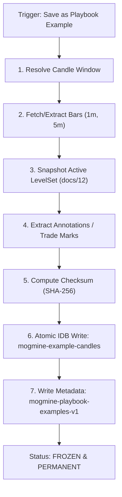

# 01 — Playbook Chart Examples: Data Architecture

> **Status:** Design proposal (`design/playbook-data-examples`).  
> **Authors:** Antigravity (Data Architecture Session) from seed by Tappy (`docs/playbook-design/00-brainstorm-tappy.md`).  
> **Context & Rules:** Strict alignment with [AGENTS.md](../../AGENTS.md) (Invariants 1, 2, 3, 5, 6, 7 and §3b rules), [docs/12](../12-levels-zones-and-daily-markup.md) (Levels & Zones), [docs/15](../15-trade-document-and-render-grammar.md) (Render Grammar), [docs/22](../22-development-mode-and-backend-boundary.md) (Local-first / boundary), and the `codex/indicator-level-trend-math` module.  
> **Constraint:** DESIGN ONLY. Do not edit application runtime code or database schemas.

---

## 1. Executive Summary & Core Philosophy

In MogMine, a **Playbook** defines the setup rules, style, and thesis. But rules without visual evidence invite drift. An **Example** is not a pointer, URL, or transient chart query: **an example is a frozen visual and tactical document**.

Like the **UX-50** precedent (where a trade copies and permanently freezes its playbook checklist at choice time so subsequent playbook edits never alter history), a Playbook Example snapshots:
1. The **exact candle window** (surviving the Yahoo Finance 30-day intraday deletion cliff).
2. The **calculated and authored level set** at that session date.
3. The **tactical annotations** (arrows, zones, text callouts) anchored in time/price coordinates.
4. The **decision point vs. outcome window** (enabling blind training and reveal mechanics).
5. The **verdict and kind** (`exemplar`, `near-miss`, or `anti-example`).
6. **Integrity and provenance metadata** (linking to a real trade or an authored historical chart).

Examples are **data first**, not flat bitmap images. They re-render natively in Lightweight Charts v5 (`ISeriesPrimitive`), scale cleanly across viewports (`390×844` mobile to desktop), respect real-time user theme variables (gold intensities, position box opacities), obey Shield/P&L redaction mode, and feed future blind-review quizzing. Rendered PNGs (Trade Card style) are downstream presentation artifacts, never the primary source of truth.

---

## 2. Example Data Model & TypeScript Interfaces

### 2.1 Reused Types vs. New Types

| Component | Status | Source / Location | Description |
| :--- | :--- | :--- | :--- |
| `Candle` | Reused | `lib/trades.ts` | `{ time: number; open: number; high: number; low: number; close: number; volume: number }` (UTC ms) |
| `Timeframe` | Reused | `lib/trades.ts` | `"1m" \| "5m" \| "15m" \| "1h"` |
| `TradeDirection` | Reused | `lib/trades.ts` | `"LONG" \| "SHORT"` |
| `TradeStyle` | Reused | `lib/trades.ts` | `"scalp" \| "session_90m" \| "investment"` |
| `LevelSet` / `LevelItem` | Reused & Extended | `fixtures/levelsets/MES-2026-11-12.json`, `docs/12` | Schema `mogmine.levelset.v1` snapshot |
| `DEFAULT_OWNER_USER_ID` | Reused | `lib/trades.ts` | Mandatory `user_id` invariant (Invariant 7) |
| `PlaybookExample` | **NEW** | `lib/playbook-examples.ts` | The core example document model (`mogmine.playbook_example.v1`) |
| `ExampleAnnotation` | **NEW** | `lib/playbook-examples.ts` | Time/price anchored graphical markup |
| `ExampleLevelSnapshot` | **NEW** | `lib/playbook-examples.ts` | Lightweight frozen subset of session key levels |
| `PlaybookCandleStore` | **NEW** | `lib/idb.ts` | Dedicated IndexedDB store for frozen example bars |

### 2.2 Core TypeScript Interfaces

```typescript
// lib/playbook-examples.ts

import type { Candle, Timeframe, TradeDirection, TradeStyle } from "./trades.ts";
import { DEFAULT_OWNER_USER_ID } from "./trades.ts";

export const PLAYBOOK_EXAMPLE_SCHEMA = "mogmine.playbook_example.v1" as const;

/**
 * The tactical verdict of the example.
 * - exemplar: Textbook setup, positive model execution ("A+").
 * - near-miss: Valid context but execution hesitated, slipped, or setup lacked 1 rule.
 * - anti-example: Looks enticing or similar on the surface, but violates core thesis / trap ("Don't take this").
 */
export type ExampleKind = "exemplar" | "near-miss" | "anti-example";

/**
 * Capture source:
 * - own-trade: Promoted directly from an executed trade log in MogMine.
 * - historical-capture: Authored from market chart history during study/review (no broker fill needed).
 */
export type ExampleSourceKind = "own-trade" | "historical-capture";

/**
 * Provenance tracking to maintain audit trail and prevent duplication.
 */
export interface ExampleProvenance {
  source_kind: ExampleSourceKind;
  /** Present if source_kind === "own-trade". Points to trade_id in TradeRecord. */
  trade_id?: string;
  /** Symbol and continuous ticker at capture. Must adhere to Invariant 3 (e.g. MES -> MES=F). */
  symbol: string;
  provider_symbol: string;
  /** Globex session date (YYYY-MM-DD) in America/New_York (session) / America/Chicago (display). */
  session_date: string;
  /** ISO timestamp when snapshot was taken and frozen. */
  captured_at: string;
  /** Capture software version / schema revision. */
  schema_version: typeof PLAYBOOK_EXAMPLE_SCHEMA;
}

/**
 * Frozen time boundaries for the example.
 * All timestamps are UTC epoch milliseconds matching Candle.time.
 */
export interface ExampleWindow {
  /** Start of the context window (pre-setup setup development). */
  start_time: number;
  /**
   * The setup trigger / decision instant.
   * In Blind Review / Quiz Mode, chart bars after this instant are initially hidden.
   */
  decision_time: number;
  /**
   * End of the primary trade / setup development.
   */
  resolution_time: number;
  /**
   * Optional full window close (hindsight / continuation context).
   */
  end_time: number;
}

/**
 * Anchored graphical annotation types.
 * Drawn via Canvas ISeriesPrimitive inside Lightweight Charts.
 */
export type AnnotationShape =
  | "arrow"         // Direct pointer to a trigger bar or level touch
  | "callout"       // Text badge with anchor line
  | "zone"          // Bounded price/time box (e.g. FVG, Order Block, Consolidation)
  | "marker"        // Icon at bar high/low (circle, cross, triangle)
  | "horizontal_ray"; // Stated trigger line extending rightwards

export interface ExampleAnnotation {
  id: string;
  shape: AnnotationShape;
  /** Anchor time in UTC epoch ms. Must snap to a candle bar time or exact event time. */
  time: number;
  /** End time for shapes spanning duration (zones, rays). */
  end_time?: number;
  /** Anchor price. Snapped to futures tick (0.25 pt for MES). */
  price: number;
  /** End price for zones. */
  end_price?: number;
  /** Label or instructional text displayed with the annotation. */
  label: string;
  /** Visual emphasis tone. */
  tone: "gold" | "bullish" | "bearish" | "neutral" | "danger";
  /** Optional rule tag linking this annotation directly to a PlaybookRule.id */
  rule_id?: string;
}

/**
 * Frozen level-set snapshot stored with the example.
 * Conforms to mogmine.levelset.v1 (docs/12).
 */
export interface ExampleLevelSnapshot {
  calc_version: string;
  session_date: string;
  /** Key levels active during the example window. */
  levels: Array<{
    key: string;
    label: string;
    type: string;
    price: number;
    price_high?: number; // for zones
    price_low?: number;  // for zones
  }>;
}

/**
 * Financial metrics frozen if promoted from an own-trade.
 * Strictly redacted when Shield Mode is active or when exported to public cards.
 */
export interface ExampleFinancialContext {
  direction: TradeDirection;
  entry_price: number;
  exit_price?: number;
  stop_loss_price?: number;
  target_price?: number;
  realized_ticks?: number;
  realized_r?: number | null;
  /** Cent amounts are strictly optional and subject to Shield Mode. */
  pnl_cents?: number;
}

/**
 * Master Playbook Example Record.
 * Stored in Playbook storage (metadata) + IndexedDB (candles).
 */
export interface PlaybookExample {
  id: string;
  playbook_id: string;
  /** Mandatory Invariant 7: user_id for zero-migration RLS alignment. */
  user_id: string;
  title: string;
  kind: ExampleKind;
  summary: string;
  what_went_right: string;
  what_went_wrong_or_missed: string;
  
  /** Technical specifications */
  symbol: string;
  base_timeframe: Timeframe;
  display_timeframes: Timeframe[];
  
  window: ExampleWindow;
  provenance: ExampleProvenance;
  financials?: ExampleFinancialContext;
  
  levels: ExampleLevelSnapshot;
  annotations: ExampleAnnotation[];
  
  /** Hash of candle window payload to verify integrity. */
  candle_checksum: string;
  bar_count: number;
  
  /** Archived flag for soft deletes. */
  archived: boolean;
  /** Manual sort order within the playbook. */
  sort_order: number;
}
```

---

## 3. Freeze Semantics & Anti-Rot Guarantee

### 3.1 The Yahoo 30-Day Wall Precedent
Yahoo Finance permanently deletes or suppresses `1m` intraday bars past 30 days (`5m`/`15m` past ~60 days). If an example merely stored a query parameter like `?symbol=MES=F&start=...&end=...`, the example would completely disintegrate into an empty chart 31 days later.

Furthermore, dynamic recalculations of session levels or trend math run on current formulas: if indicator math is updated, historical playbook examples must not shift underneath the trader.

### 3.2 The UX-50 Freeze Precedent
In `lib/playbooks.ts` and `lib/trades.ts`, when a trade selects a playbook, `checklistFor(id)` extracts a deep clone of `{ id, label, checked: false }` into `trade.checklist_state`. The trade **never re-reads the playbook**. If the trader later rewrites, deletes, or reorders the playbook rules, the existing trade retains its historical fidelity.

### 3.3 Capture-Time Freezing Pipeline
When a trader clicks **"Save as Playbook Example"** (either on Trade Detail or the Chart Study Tool):


1. **Candle Extraction:**
   - The exact window of bars (`start_time` to `end_time`) is sliced from the active candle cache.
   - If sourced from an open or fresh trade, capture enforces that the session is closed and hindsight bars exist, or warns the user that bars post-resolution are missing.
2. **Level Set Freezing:**
   - The levels engine output (`mogmine.levelset.v1`) for that `session_date` is captured. Any dynamic session VWAP/POC curves are baked into discrete lines/points or frozen coordinate arrays.
3. **Immutability Guarantee:**
   - Once saved, `candle_checksum` seals the bar payload.
   - Future edits to the parent Playbook (renaming the setup, changing checklist items, or archiving the playbook) **do not alter the example**.
   - If the parent playbook is archived, its examples remain intact and accessible in read-only/archive review mode.

---

## 4. Storage Architecture & Tiering

### 4.1 Tiering Strategy (Local-First to Supabase)

MogMine operates under local-first principles ([docs/22](../22-development-mode-and-backend-boundary.md)). The storage tiers are cleanly partitioned:

```
+-----------------------------------------------------------------------------------+
| Tier 1: localStorage (`mogmine-playbook-examples-v1`)                             |
|  - Example metadata ONLY (id, playbook_id, title, kind, window, annotations,     |
|    levels snapshot, checksum, sort_order).                                        |
|  - NO raw candle bars.                                                           |
+-----------------------------------------------------------------------------------+
| Tier 2: IndexedDB (`mogmine` database, object store `playbook_candles`)          |
|  - Key: `example_id` (or `content_hash`).                                        |
|  - Value: `{ example_id, signature, candles: Candle[], checksum, stored_at }`    |
|  - Retains all raw bars offline on the mobile device.                             |
+-----------------------------------------------------------------------------------+
| Tier 3: Supabase Tables (Future / Post-PR #71 & R-05)                            |
|  - `public.playbook_examples` (relational metadata + JSONB annotations/levels).   |
|  - `public.playbook_example_candles` (relational bar store keyed by example_id).  |
|  - RLS enforced via `user_id = auth.uid()` (DEFAULT_OWNER_USER_ID today).        |
+-----------------------------------------------------------------------------------+
```

### 4.2 Size Estimates & Realistic Device Caps

#### Per-Example Metrics:
- **Typical Window Duration:** 4 hours (e.g. 08:00 to 12:00 CT).
- **1m Bars in 4 hours:** 240 bars.
- **5m Bars in 4 hours:** 48 bars.
- **Bytes per Candle:** ~40 bytes in binary/JSON representation (`[time, open, high, low, close, volume]`).
- **Raw Candle Payload:** `240 * 40 bytes ≈ 9.6 KB` (1m) + `48 * 40 bytes ≈ 1.9 KB` (5m) ≈ **11.5 KB**.
- **Metadata + Annotations + Levels JSON:** ~**3.5 KB**.
- **Total per Example:** **~15 KB**.

#### Capacity Budget:
- 10 Playbooks × 5 Examples each = 50 Examples.
- 50 Examples × 15 KB = **750 KB total storage**.
- Even an aggressive library of 200 examples consumes only **~3 MB**, which is negligible inside IndexedDB (typical mobile browser quota is >500 MB to gigabytes).
- **localStorage Footprint:** Storing 50 metadata records (at ~3.5 KB each) takes **~175 KB**, well under the standard 5 MB `localStorage` threshold.

### 4.3 Deduplication of Candle Windows

If a trader creates multiple examples from the same session (e.g. an "A+ Entry" and an "Anti-Example Chase" occurring on the same morning on `MES-2026-11-12`), storing duplicate 1m bar arrays is wasteful.

**Deduplication Strategy:**
- The candle store in IndexedDB can index by a composite hash: `candle_window_hash = sha256(symbol + base_timeframe + start_time + end_time)`.
- When saving an example, check if `candle_window_hash` already exists in `playbook_candles`.
- If it exists, link the example's `candle_checksum` to that record, incrementing a reference count.
- Deleting an example decrements the ref count; bars are purged only when no examples reference that window.

### 4.4 Migration Path from `mogmine-playbooks-v1`

Today's `mogmine-playbooks-v1` (`lib/playbooks-store.ts`) stores an array of `Playbook`:
```json
[
  {
    "id": "orb-reclaim",
    "user_id": "demo-owner",
    "name": "ORB Reclaim",
    "default_style": "scalp",
    "checklist_rules": [...],
    "archived": false
  }
]
```

**Zero-Breaking-Change Migration:**
1. Keep `mogmine-playbooks-v1` schema intact. Do **not** inject heavy example objects directly into the `Playbook` array in `localStorage`.
2. Introduce `mogmine-playbook-examples-v1` in `localStorage` for example metadata.
3. Provide a joined selector in `lib/playbooks-store.ts`:
   ```typescript
   export function getPlaybookWithExamples(playbookId: string): {
     playbook: Playbook;
     examples: PlaybookExample[];
   }
   ```
4. Upgrading devices see an empty `mogmine-playbook-examples-v1` array. All default seeds load seamlessly with `examples: []`.

---

## 5. Level Set Snapshots (Integration with `docs/12` & Codex Math)

### 5.1 Level Snapshot Schema
`fixtures/levelsets/MES-2026-11-12.json` and [docs/12](../12-levels-zones-and-daily-markup.md) define the canonical level set (`mogmine.levelset.v1`). For a playbook example, we do not need to store the entire premarket planning narrative, but we **must freeze the concrete levels and zones that price interacted with**.

```typescript
export interface ExampleLevelSetPayload {
  schema: "mogmine.levelset.v1";
  symbol: "MES";
  provider_symbol: "MES=F";
  session_date: string; // YYYY-MM-DD
  calc_version: string; // e.g. "levels-v1" or "codex-math-v1"
  levels: Array<{
    key: string;            // e.g. "onh", "onl", "pdh", "pdl", "r1", "vwap", "adr_high"
    type: string;           // e.g. "overnight_high", "prior_day_high", "session_vwap"
    label: string;          // e.g. "ONH", "PDH", "VWAP", "ADR High"
    price: number;          // primary snapped price
    price_high?: number;    // zone upper bound
    price_low?: number;     // zone lower bound
    zone?: string;
  }>;
  /** Session anchors active during the window */
  session_context: {
    rth_open?: number;
    globex_open?: number;
    prior_settle?: number;
    onh?: number;
    onl?: number;
  };
}
```

### 5.2 Dynamic Math from `codex/indicator-level-trend-math`
When the indicator math module becomes available, session VWAP and dynamic POC lines are computed from the candle stream.
- In the frozen example, continuous indicators (like VWAP) can either be:
  1. **Recomputed on the fly** from the frozen 1m candle array (since pure mathematical functions over identical candles produce bit-for-bit identical results).
  2. **Frozen as discrete anchor values** at key points (e.g. VWAP at decision time, VWAP standard deviation bands at entry).
- **Rule:** Global session levels (PDH, PDL, ONH, ONL, Settlement, ADR) are frozen in `ExampleLevelSnapshot` at capture. Dynamic series (VWAP) are derived deterministically by the chart renderer from the frozen candle series.

---

## 6. Annotations as Data & Shield Redaction

### 6.1 Data-First Annotations vs. Canvas PNG
Annotations are strictly stored as vector math in data coordinates:
```typescript
{
  id: "ann-01",
  shape: "arrow",
  time: 1762952400000,   // 2026-11-12T08:40:00Z
  price: 7618.50,
  label: "Liquidity Sweep of ONL",
  tone: "gold",
  rule_id: "htf-bias"
}
```
**Why data-first?**
1. **Interactive Scrubbing & Crosshair:** Mobile traders can pinch-zoom and drag the crosshair across the setup.
2. **Dynamic Theming:** The annotation colors respect `--gold-gradient`, `--gold-mid`, and dark mode palettes.
3. **Multi-Timeframe Reprojection:** A 1m callout can be toggled to a 5m view without re-authoring.
4. **Blind Review / Quiz Mode:** We can selectively suppress annotations on the chart until the user taps "Reveal Analysis".

### 6.2 Shield / P&L Redaction Alignment
MogMine includes **Shield Mode** (Invariants 5 & 7, `docs/03`, `docs/08`) to protect trader privacy when viewing charts in public, coffee shops, or sharing online:
- If `Shield Mode === ON`:
  - `realized_ticks`, `realized_r`, and `pnl_cents` are completely masked (`***` or hidden).
  - Any annotation containing dollar figures or account balance references has those tokens redacted via the Shield parser.
  - Position Box fill opacities remain visible, but dollar metric badges are suppressed.
- **Exporting Trade Cards:**
  - PNG generation renders from the data model. When exporting, the export engine explicitly checks the user's Shield toggle. If enabled, the generated PNG contains clean R-multiples or purely technical annotations with no dollar amounts or account identifiers.

---

## 7. Integrity & Failure Modes (Fail-Closed Matrix)

In alignment with MogMine's core philosophy (docs/08 §4, docs/09 §2), the example viewer **fails closed**: it never draws hallucinated bars, invented targets, or false setups.

| Failure Mode | Root Cause | System Behavior & Fallback |
| :--- | :--- | :--- |
| **Missing Bar Window** | IndexedDB cleared by iOS Safari 7-day storage pressure or user cache flush. | **Fail-Closed.** Show dedicated empty state card: *"Example candle cache expired on this device. Re-download from archive [Retry]"*. Never render a broken flat line. |
| **Partial Window / Gaps** | Incomplete historical fetch at time of capture (e.g. holiday early close). | Chart renders available bars. Draws vertical dashed gap indicators with label: `Data gap: exchange pause`. Displays data badge: `Partial Session`. |
| **Symbol / Timeframe Mismatch** | Playbook default is `session_90m` on `15m`, but example was captured on `1m`. | Chart loads `1m` base candles, dynamically builds aggregated `5m` or `15m` bars using pure `aggregateCandles` logic. If aggregation fails, defaults to `base_timeframe`. |
| **Corrupt IndexedDB Payload** | JSON deserialization error or failed SHA-256 checksum check. | Status marked `corrupt`. Emits warning toast: *"Example data integrity check failed."* Prevents corrupt data from being used in Quiz/Blind scoring. |
| **Archived Playbook** | Parent Playbook was marked `archived: true`. | Examples remain completely viewable in Read-Only mode under *"Archived Playbooks"*. Cannot add new examples until playbook is restored. |

---

## 8. Phased Build Order

### Phase 1: Local Foundation & Core Types (Smallest Viable Slice)
- [ ] Define `lib/playbook-examples.ts` with `PlaybookExample`, `ExampleAnnotation`, and `ExampleLevelSnapshot`.
- [ ] Add `playbook_candles` store to `lib/idb.ts` (increment DB version to 2 with safe upgrade handler).
- [ ] Create `lib/playbook-examples-store.ts` managing `mogmine-playbook-examples-v1` in `localStorage`.
- [ ] Build unit test suite verifying:
  - Deep freeze and checksum verification.
  - Slicing and caching of candle windows.
  - Integrity validation and fail-closed handling.

### Phase 2: Capture Engine ("Save as Example")
- [ ] Add **"Save to Playbook"** action sheet to `TradeDetail.tsx`.
- [ ] Implement capture pipeline: slice current trade candles, freeze current session levels from `docs/12`, snap entry/exit/stop annotations.
- [ ] Allow classifying example kind (`exemplar`, `near-miss`, `anti-example`).
- [ ] Test on mobile viewport (`390×844`).

### Phase 3: Playbook Example Gallery & Viewer
- [ ] Extend Playbook Detail in Tune screen (`TuneScreen.tsx` / `components/PlaybookViewer.tsx`).
- [ ] Render gallery carousel of saved examples (mini sparklines or compact preview cards).
- [ ] Full interactive chart modal rendering the frozen bars, Position Box layers, and `ExampleAnnotation` marks via Lightweight Charts.

### Phase 4: Blind Study & Share Card Export
- [ ] Implement "Blind Review / Decision Point" slider: hides bars past `decision_time`, prompts user: *"Take this setup? Long / Short / Pass"*, then reveals outcome and analysis.
- [ ] Export Playbook Card (Trade Card PNG generator format adapted for Playbook Examples).

---

## 9. Risks & Owner Decisions (Flagged for Review)

The following decisions are flagged for the project owner (`wyrmspire`). Agents must not decide these unilaterally:

1. **Standalone Historical Capture Tool (`OD-PB-01`):**
   - *Question:* Can examples be authored from historical charts where the trader never took a live trade?
   - *Recommendation:* **Yes.** Crucial for back-studying setups and populating a playbook before live trading. Requires adding a "Capture Chart Window" button in the Chart Study view.

2. **Placement of Anti-Examples (`OD-PB-02`):**
   - *Question:* Should `anti-examples` live strictly inside their parent Playbook (e.g. inside "ORB Reclaim"), or should there also be a global "Hall of Traps / Red Flag Gallery"?
   - *Recommendation:* Stored in the parent playbook with `kind: "anti-example"`, but indexed globally by a filter in Tune so the trader can review all traps across all setups before the morning bell.

3. **Multi-Timeframe Storage Strategy (`OD-PB-03`):**
   - *Question:* Should we store *both* `1m` and `15m` candle series in IndexedDB, or store *only* `1m` bars and aggregate to `5m`/`15m` in memory?
   - *Recommendation:* Store **only `1m` bars** in IndexedDB and derive higher timeframes dynamically. This cuts storage by 60% and guarantees zero drift between timeframes.

4. **Default Outcome Visibility (`OD-PB-04`):**
   - *Question:* When opening an example in the playbook gallery, should the resolution window be visible immediately, or should it open in Blind Mode (hidden past `decision_time`) by default?
   - *Recommendation:* Open fully revealed by default in the gallery; provide an explicit **"Quiz Me / Blind Run"** button for active training.

5. **Playbook Package Portability (`OD-PB-05`):**
   - *Question:* Will playbooks ever be exportable/importable as a single `.mogplaybook` JSON bundle (rules + checklist + frozen example data + card snapshots)?
   - *Recommendation:* Yes, design the schema to be self-contained so that a single JSON export contains both the metadata and the base64/array candle data.
